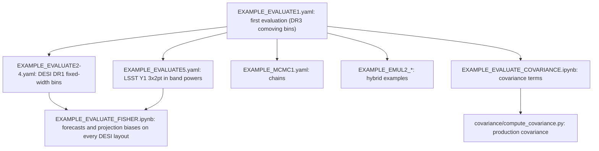

# Table of contents <a name="table_of_contents"></a>

1. [The DESI DR3 × LSST Y1 forecast](#forecast)
2. [Reading path through the examples](#reading_path)
3. [Running Cosmolike projects (Basic instructions)](#running_cosmolike_projects)
4. [The DESI DR1 fixed-width Δz cases](#dz_cases)
5. [The LSST Y1 3×2pt case](#lsst_case)
6. [Baryonic feedback on EXAMPLE_EVALUATE1](#baryonic_feedback)
7. [Running Hybrid Cosmolike-ML emulators](#cobaya_base_code_examples_emul2)
8. [Running Fisher](#fisher)
9. [Unit tests](#unit_tests)
10. [Computing covariances](#computing_covariances)
11. [Exploring notebooks](#notebooks)
12. [Appendix: Which accuracy settings are available?](#accuracy)

# The DESI DR3 × LSST Y1 forecast <a name="forecast"></a>

This project forecasts DESI DR3 spectroscopic galaxy clustering joint
with LSST Y1 cosmic shear in Fourier band powers. The galaxy sample is
split into 76 thin comoving lens bins of about 62.3 Mpc (BGS, LRG1-3,
ELG1-2; mean redshifts 0.11 to 1.55;
`data/lssty1xdesi_desi_dr3_bins.txt` names each bin's sample chunk and
`data/lssty1xdesi_desi_dr3_ngal.txt` its density). The data vector
holds 15 shear pairs, 76 clustering autos and 97 measured cross-bin
clustering pairs, each in 53 bands of width $`\Delta\ell = 10`$
covering $`15 \le \ell \le 544`$: 9,964 entries, 5,309 of them
unmasked. No galaxy-galaxy lensing rows are measured
(`ggl_exclude: all`).

The thin bins are the project's defining numerical challenge. Their
radial kernels keep real non-Limber power far past the multipole where
photometric surveys hand off to Limber, and the Fingers-of-God
smearing couples neighboring bins. The likelihood therefore computes
the full density-density term with the low-rank non-Limber engine
(`adopt_limber_gg: 0`, `nonlimber_lowrank_gg: 1`) and rebuilds the 76
lens distributions through the Fingers-of-God convolution at every
evaluation (`external_nz_modeling: 1`): a velocity dispersion
$`\sigma_v`$ smears observed redshifts by
$`\sigma_z = (1 + \bar z)\,\sigma_v/c`$, and the bins are far narrower
than that smearing.

The bins share their nuisance parameters by sample: one linear bias
per sample chunk (`DESI_B1_*`: BGS, LRG1-3, ELG1-2) and seven sampled
velocity dispersions (`DESI_SIGV_*`, with BGS split in two).
`likelihood/desi_cl.py` scores the band-power vector; the `combo_*`
variants expose the probe subsets. The survey inputs (densities,
fiducial biases, $`f_{\rm sky} = 0.3394`$, the supplied comparison
covariance) are ported from the source DESI DR3 × LSST Y1 forecast;
the [covariance guide](covariance/README.md#source_forecast) records
the model-choice differences the comparison revealed.

# Reading path through the examples <a name="reading_path"></a>

Start with one evaluation of `EXAMPLE_EVALUATE1.yaml`
([basic instructions](#running_cosmolike_projects)): it checks the
installation that every later example uses.



- `EXAMPLE_EVALUATE1.yaml` evaluates the fiducial point of the DR3
  comoving binning; a commented `bfmt` theory block shows how to turn
  each baryonic-feedback model on
  ([baryonic feedback](#baryonic_feedback)).
- `EXAMPLE_EVALUATE2.yaml` to `EXAMPLE_EVALUATE4.yaml` evaluate the
  DESI DR1 binnings of fixed width in redshift, and
  `EXAMPLE_EVALUATE5.yaml` the LSST Y1 3×2pt case
  ([Δz cases](#dz_cases), [LSST case](#lsst_case)).
- `EXAMPLE_EMUL2_EVALUATE1.yaml` is the hybrid-emulator variant of the
  first example, with MCMC and Nautilus examples alongside
  ([hybrid emulators](#cobaya_base_code_examples_emul2)).
- `EXAMPLE_EVALUATE_FISHER.ipynb` forecasts, on every DESI layout, the
  constraints of DESI clustering, LSST Y1 3×2pt and their combination,
  and the parameter biases of the projection approximations
  ([running Fisher](#fisher)).
- The covariance notebook and the production CLI need the optional
  covariance build ([computing covariances](#computing_covariances)).
- [tests/](tests/README.md) checks the predictions against stored
  references ([unit tests](#unit_tests)).

# Running Cosmolike projects (Basic instructions) <a name="running_cosmolike_projects"></a>

From `Cocoa/Readme` instructions:

> [!Note]
> `setup_cocoa.sh` and `compile_cocoa.sh` install and compile the cosmolike projects selected in `set_installation_options.sh`. A commented `IGNORE_COSMOLIKE_*_CODE` key enables a project; an active key skips it. This project ships skipped: comment out its key before running the two scripts.
>
>     [Adapted from Cocoa/set_installation_options.sh shell script]
>     (...)
>     # WARNING: lssty1xdesi is under active development.
>     export IGNORE_COSMOLIKE_LSSTY1XDESI_CODE=1
>     (...)
>     export LSSTY1XDESI_URL="https://github.com/SBU-COSMOLIKE/lssty1xdesi.git"
>     export LSSTY1XDESI_NAME="lssty1xdesi"
>     export LSSTY1XDESI_GIT_BRANCH="main"
>
> To select another revision, set only one of the project's `GIT_COMMIT`, `GIT_BRANCH` or `GIT_TAG` keys (here `LSSTY1XDESI_GIT_COMMIT`, `LSSTY1XDESI_GIT_BRANCH` or `LSSTY1XDESI_GIT_TAG`): a commit takes precedence over a branch, and a branch over a tag.

> [!NOTE]
> If users want to recompile cosmolike, there is no need to rerun the Cocoa general scripts. Instead, run the following three commands:
>
>      source start_cocoa.sh
>
> and
>
>      source ./installation_scripts/setup_cosmolike_projects.sh
>
> and
>
>       source ./installation_scripts/compile_all_projects.sh
>
> or (in case users just want to compile this project)
>
>       source ./projects/lssty1xdesi/scripts/compile_lssty1xdesi.sh

> [!TIP]
> Assuming Cocoa is installed on a local (not remote!) machine, type the command below after step 2️⃣ to run Jupyter Notebooks.
>
>     jupyter notebook --no-browser --port=8888
>
> The terminal will then show a message similar to the following template:
>
>     (...)
>     [... NotebookApp] Jupyter Notebook 6.1.1 is running at:
>     [... NotebookApp] http://f0a13949f6b5:8888/?token=XXX
>     [... NotebookApp] or http://127.0.0.1:8888/?token=XXX
>     [... NotebookApp] Use Control-C to stop this server and shut down all kernels (twice to skip confirmation).
>
> Now go to the local internet browser and type `http://127.0.0.1:8888/?token=XXX`, where XXX is the previously saved token displayed on the line
>
>     [... NotebookApp] or http://127.0.0.1:8888/?token=XXX
>
> The project contains jupyter notebook examples located at `projects/lssty1xdesi`.

> [!NOTE]
> The example notebooks load their shared support functions from
> `Cocoa/external_modules/code/cosmolike_core/cosmolike_notebook_utils/`,
> called through the `cnu` namespace: the CAMB run packaged for
> cosmolike, the data-vector helpers, and the Fisher-forecast helpers.
> What is specific to this project lives in
> `interface/cosmolike_lssty1xdesi_fisher.py` (the `ModelFisher` class
> of the [Fisher examples](#fisher)).

To run the example

 **Step :one:**: activate the Cocoa Conda environment,  and the private Python environment

      conda activate cocoa

and

      source start_cocoa.sh

 **Step :two:**: Select the number of OpenMP cores (the commands below set it to 8).

  - Linux

        export OMP_NUM_THREADS=8; export OMP_PROC_BIND=close; \
        export OMP_PLACES=cores; export OMP_DYNAMIC=FALSE; \
        export OPENBLAS_NUM_THREADS=1; export MKL_NUM_THREADS=1

  - macOS (arm)

        export OMP_NUM_THREADS=8; export OMP_PROC_BIND=disabled; \
        export OMP_PLACES=cores; export OMP_DYNAMIC=FALSE; \
        export OPENBLAS_NUM_THREADS=1; export MKL_NUM_THREADS=1

 **Step :three:**: The folder `projects/lssty1xdesi` contains examples. So, run the `cobaya-run` on the first example following the commands below.

> [!Warning]
> (Linux only) In some HPC nodes, `numa` can cause you problems. If that is the case,
> replace `numa` with `slot`

- **One model evaluation**:

  - Linux

        "${CONDA_PREFIX}"/bin/mpirun -n 1 --oversubscribe --mca pml ob1 --mca btl vader,tcp,self \
          --bind-to core:overload-allowed --report-bindings \
          --rank-by slot --map-by numa:pe=${OMP_NUM_THREADS} \
          cobaya-run ./projects/lssty1xdesi/EXAMPLE_EVALUATE1.yaml -f

  - macOS (arm)

        mpirun -n 1 --oversubscribe \
          cobaya-run ./projects/lssty1xdesi/EXAMPLE_EVALUATE1.yaml -f

- **MCMC (Metropolis-Hastings Algorithm)**:

  - Linux

        "${CONDA_PREFIX}"/bin/mpirun -n 4 --oversubscribe --mca pml ob1 --mca btl vader,tcp,self \
          --bind-to core:overload-allowed --report-bindings \
          --rank-by slot --map-by numa:pe=${OMP_NUM_THREADS} \
          cobaya-run ./projects/lssty1xdesi/EXAMPLE_MCMC1.yaml -f

  - macOS (arm)

        mpirun -n 4 --oversubscribe \
          cobaya-run ./projects/lssty1xdesi/EXAMPLE_MCMC1.yaml -f

# The DESI DR1 fixed-width Δz cases <a name="dz_cases"></a>

The comoving DR3 layout above splits the samples into bins of fixed
comoving width. The DESI DR1 forecast distributions instead split BGS,
LRG and ELG into bins of fixed width $`\Delta z`$ in redshift. Three
widths are set up as separate cases of the same likelihood, each with
its own data files (`data/lssty1xdesi_desi_dr1_dz0pXX*`), likelihood
class (`likelihood/desi_cl_dr1_dz0pXX.py`), parameter file and EXAMPLE
yaml:

| Case | $`\Delta z`$ | Lens bins | Cross pairs | Entries | Unmasked | `accuracyboost` | `nonlimber_accuracyboost` | EXAMPLE |
|---|---:|---:|---:|---:|---:|---:|---:|---|
| `dr1_dz0p20` | 0.2 | 10 | 13 | 2,014 | 744 | 2 | 4 | `EXAMPLE_EVALUATE4.yaml` |
| `dr1_dz0p05` | 0.05 | 36 | 52 | 5,459 | 2,982 | 2 | 16 | `EXAMPLE_EVALUATE3.yaml` |
| `dr1_dz0p02` | 0.02 | 90 | 133 | 12,614 | 7,621 | 2 | 32 | `EXAMPLE_EVALUATE2.yaml` |

The distributions come without bandpowers, pairs or scale cuts, so
`scripts/make_desi_dz_case.py` builds them with the conventions of the
DR3 sacc file. Its docstring states each rule; in short:

- **bands**: the 53 DR3 bands;
- **cross pairs**: every two bins whose distributions overlap or
  touch;
- **scale cuts**: an auto spectrum keeps the bands with
  $`\ell + 1/2 \le k_\mathrm{max}\,\chi(\bar z)`$, with
  $`k_\mathrm{max} = 0.1185\ \mathrm{Mpc}^{-1}`$, $`\chi`$ the comoving
  distance and $`\bar z`$ the bin's mean redshift; a cross pair keeps
  the bands both of its autos keep;
- **densities**: only the per-bin `ngal` of the forecast's
  `probes_properties` files is used. Their other entries are not
  current.

Narrower bins need a finer FFTLog grid along the line of sight: the
non-Limber integrand oscillates on the scale of the bin's width, and a
coarse grid aliases it. Each case's likelihood yaml sets the reference
`accuracyboost` and `nonlimber_accuracyboost` of the table above and
records the measured $`\Delta\chi^2`$ ladder behind them; the
[appendix](#accuracy) explains how the two settings combine into the
line-of-sight grid.

The covariance of each case is the Gaussian term of the project's
covariance code, at the DESI footprint of 14,000 deg². It is stored
sparse in the cosmolike text format (only nonzero entries, upper
triangle). Like every covariance file under `data/`, it is built
locally and not tracked by git (steps two and three below); the test
snapshot in `tests/frozen/data/` keeps a copy.

A case is rebuilt in four steps, shown here for $`\Delta z = 0.02`$.
The DR1 distribution files are not distributed with the project:
`--input-dir` names their folder. The second step needs the project
compiled with its covariance interface
([covariance guide](covariance/README.md)).

**Step :one:**: build the case's data files.

```bash
python ./projects/lssty1xdesi/scripts/make_desi_dz_case.py --width 0.02 --stage files --input-dir /path/to/dr1_inputs
```

**Step :two:**: compute the case's Gaussian covariance.

```bash
python ./projects/lssty1xdesi/covariance/compute_covariance.py ./projects/lssty1xdesi/EXAMPLE_EVALUATE_COVARIANCE2.yaml
```

**Step :three:**: install the covariance into the case's data files.

```bash
python ./projects/lssty1xdesi/scripts/make_desi_dz_case.py --width 0.02 --stage covariance
```

**Step :four:**: write the fiducial data vector.

```bash
python ./projects/lssty1xdesi/scripts/make_desi_dz_case.py --width 0.02 --stage fiducial
```

The last step writes the model vector at the EXAMPLE's fiducial point
as the case's data vector, so the EXAMPLE evaluates to
$`\chi^2 \approx 0`$.

# The LSST Y1 3×2pt case <a name="lsst_case"></a>

`EXAMPLE_EVALUATE5.yaml` evaluates LSST Y1 alone. It has cosmic shear,
galaxy-galaxy lensing and clustering, all in band powers on the same
53 bands, which is what lets its Fisher matrix add to a DESI case's.
The lens and source distributions are the lsst_y1 project's
(`data/lssty1xdesi_lens.nz`, `data/lssty1xdesi_source.nz`, five bins
each, read with that project's convention: the z column is the lower
edge of each histogram bin). The likelihood
`likelihood/lsst_y1_3x2pt.py` is `combo_3x2pt` in Fourier space: FKEM
non-Limber clustering and galaxy-galaxy lensing below $`\ell = 150`$.

| Block | Spectra | Entries | Kept by the mask |
|---|---:|---:|---|
| cosmic shear | 15 | 795 | every band |
| galaxy-galaxy lensing | 25 | 1,325 | the lens bin's clustering cut |
| clustering | 5 | 265 | $`\ell + 1/2 \le k_\mathrm{max}\,\chi(\bar z)`$ |

That leaves 1,629 unmasked entries out of 2,385.

The covariance is the Gaussian term at 12,300 deg², with the shape
noise and densities of the LSST Y1 science requirements (sources
2 arcmin⁻² per bin and $`\sigma_e = 0.26`$ per component, lenses
3.6 arcmin⁻² per bin). The shear and lensing signals in it include
nonlinear-alignment intrinsic alignments, with the fiducial power law
evaluated at each source bin's mean redshift.
`scripts/make_lsst_3x2pt_case.py` builds the case with the four steps
of the Δz builder (`--stage files`, then the covariance CLI on
`EXAMPLE_EVALUATE_COVARIANCE5.yaml`, then `--stage covariance` and
`--stage fiducial`).

# Baryonic feedback on EXAMPLE_EVALUATE1 <a name="baryonic_feedback"></a>

`EXAMPLE_EVALUATE1.yaml` can apply an external baryonic feedback
suppression to the matter power spectrum via the `bfmt` theory block
(SP(k), BCEmu, Flamingo, BACCOemu, or BCemu2025). By default, the
example runs without feedback.

**Step :one:**: ensure the lines below are commented out in
`set_installation_options.sh` before running `setup_cocoa.sh` and
`compile_cocoa.sh`. *By default, these lines should be commented out,
but it is worth checking*.

      [Adapted from Cocoa/set_installation_options.sh shell script]
      #export IGNORE_PYSPK_CODE=1
      #export IGNORE_BCEMU_CODE=1
      #export IGNORE_FBRE_CODE=1
      #export IGNORE_BACCOEMU_CODE=1
      (...)
      #export IGNORE_BFMT_CODE=1 # Baryon Feedback Theory Block from Nihar&JVicente

**Step :two:**: in `EXAMPLE_EVALUATE1.yaml`, uncomment the `bfmt`
theory block and select the model:

      theory:
        bfmt:
          baryon_model: 2 # 1 = SP(k), 2 = BCEmu, 3 = FlamingoEmulator, 4 = BACCOemu, 5 = BCemu2025

**Step :three:**: set `external_baryon_suppression: True` on the
`lssty1xdesi.desi_cl` likelihood block.

**Step :four:**: add the selected model's sampled parameters to the
`params` block and to the `sampler: evaluate: override` block.

> [!NOTE]
> BACCOemu (`baryon_model: 4`) rejects this example's fiducial
> `omegab: 0.04`, the edge of its baryon-density training box. Move
> `omegab` inside that box before selecting it.

> [!TIP]
> For the sampled parameters of each model, their validity ranges, and
> the `bfmt` options, see
> `Cocoa/external_modules/code/baryon_suppression/README.md`. The
> baryonic-feedback drift tests of the
> [test guide](tests/README.md) exercise every model against stored
> per-model vectors.

# Running Hybrid Cosmolike-ML emulators <a name="cobaya_base_code_examples_emul2"></a>

> [!NOTE]
> These hybrid examples verify the workflow; assess emulator accuracy
> and posterior convergence for your analysis. The thin DESI bins
> resolve emulator error that broad photometric bins average over, so
> the advisory emulator checks of the [test guide](tests/README.md)
> measure the shipped networks' offset from the exact physics before
> any production use.

The `EXAMPLE_EMUL2` examples emulate the background expansion and
matter power spectra (`use_emulator: 2`). CosmoLike still computes the
survey projections, bias, intrinsic-alignment and Fingers-of-God
contributions, so changing n(z) or nuisance parameters does not
require retraining a survey data-vector network. All three examples
run `lssty1xdesi.desi_cl` on the DR3 layout:

| Example | File |
|---|---|
| Fixed evaluation | [EXAMPLE_EMUL2_EVALUATE1.yaml](EXAMPLE_EMUL2_EVALUATE1.yaml) |
| Cobaya MCMC | [EXAMPLE_EMUL2_MCMC1.yaml](EXAMPLE_EMUL2_MCMC1.yaml) |
| Nautilus sampling | [EXAMPLE_EMUL2_NAUTILUS1.py](EXAMPLE_EMUL2_NAUTILUS1.py) |

The shared theory networks live in `external_modules/data/emultrf`.
Install them through the
[main Cocoa emulator recipe](https://github.com/CosmoLike/cocoa#cobaya_base_code_examples_emul2).
These networks assume **mnu = 0.06 eV**; do not sample neutrino mass.
Check their training range before widening cosmological priors.

We assume Cocoa and this project are installed, the Cocoa Conda
environment is active, the shell is Bash, and the current folder is
`cocoa/Cocoa/`.

**Step :one:**: activate Cocoa.

```bash
source start_cocoa.sh
```

**Step :two:**: Select the number of OpenMP cores (below, we set it to 4).

  - Linux

        export OMP_NUM_THREADS=4; export OMP_PROC_BIND=close; \
        export OMP_PLACES=cores; export OMP_DYNAMIC=FALSE; \
        export OPENBLAS_NUM_THREADS=1; export MKL_NUM_THREADS=1

  - macOS (arm)

        export OMP_NUM_THREADS=4; export OMP_PROC_BIND=disabled; \
        export OMP_PLACES=cores; export OMP_DYNAMIC=FALSE; \
        export OPENBLAS_NUM_THREADS=1; export MKL_NUM_THREADS=1

**Step :three:**: remove GPU access on Linux; these examples use the CPU.

```bash
export CUDA_VISIBLE_DEVICES=""
```

**Step :four:**: evaluate the first hybrid example.

- Linux

      "${CONDA_PREFIX}"/bin/mpirun -n 1 --oversubscribe \
        --mca pml ob1 --mca btl vader,tcp,self \
        --bind-to core:overload-allowed --report-bindings \
        --rank-by slot --map-by numa:pe=${OMP_NUM_THREADS} \
        cobaya-run ./projects/lssty1xdesi/EXAMPLE_EMUL2_EVALUATE1.yaml --force

- macOS (arm)

      mpirun -n 1 --oversubscribe \
        cobaya-run ./projects/lssty1xdesi/EXAMPLE_EMUL2_EVALUATE1.yaml --force

Keep BLAS at one thread per MPI rank (`OPENBLAS_NUM_THREADS=1`,
`MKL_NUM_THREADS=1`); on macOS also use `VECLIB_MAXIMUM_THREADS=1`.

### Cobaya MCMC

With the same assumptions, run the hybrid MCMC example. Check chain
convergence before interpreting posterior constraints.

**Step :one:**: Select the number of OpenMP cores (below, we set it to 8).

  - Linux

        export OMP_NUM_THREADS=8; export OMP_PROC_BIND=close; \
        export OMP_PLACES=cores; export OMP_DYNAMIC=FALSE; \
        export OPENBLAS_NUM_THREADS=1; export MKL_NUM_THREADS=1

  - macOS (arm)

        export OMP_NUM_THREADS=8; export OMP_PROC_BIND=disabled; \
        export OMP_PLACES=cores; export OMP_DYNAMIC=FALSE; \
        export OPENBLAS_NUM_THREADS=1; export MKL_NUM_THREADS=1

**Step :two:**: remove GPU access on Linux; these examples use the CPU.

```bash
export CUDA_VISIBLE_DEVICES=""
```

**Step :three:**: start Cobaya's hybrid MCMC.

- Linux

      "${CONDA_PREFIX}"/bin/mpirun -n 4 --oversubscribe \
        --mca pml ob1 --mca btl vader,tcp,self \
        --bind-to core:overload-allowed --report-bindings \
        --rank-by slot --map-by numa:pe=${OMP_NUM_THREADS} \
        cobaya-run ./projects/lssty1xdesi/EXAMPLE_EMUL2_MCMC1.yaml

- macOS (arm)

      mpirun -n 4 --oversubscribe \
        cobaya-run ./projects/lssty1xdesi/EXAMPLE_EMUL2_MCMC1.yaml

### Nautilus

With the same assumptions and CPU setup as the MCMC subsection:

**Step :one:**: check the hybrid setup before a long run.

```bash
python ./projects/lssty1xdesi/EXAMPLE_EMUL2_NAUTILUS1.py --check
```

**Step :two:**: run Nautilus as an independent sampling example.

- Linux

      "${CONDA_PREFIX}"/bin/mpirun -n 90 --oversubscribe \
        --mca pml ob1 --mca btl vader,tcp,self \
        -x PATH -x LD_LIBRARY_PATH -x PYTHONPATH -x CONDA_PREFIX -x ROOTDIR \
        -x OMP_NUM_THREADS -x OMP_PROC_BIND -x OMP_PLACES -x OMP_DYNAMIC \
        -x OPENBLAS_NUM_THREADS -x MKL_NUM_THREADS -x CLIK_PATH -x CLIK_DATA \
        -x CLIK_PLUGIN -x CUDA_VISIBLE_DEVICES --mca mpi_yield_when_idle 1 \
        --mca btl_tcp_if_exclude lo,docker0,virbr0,ib0 \
        --bind-to core:overload-allowed --report-bindings \
        --rank-by slot --map-by numa:pe=${OMP_NUM_THREADS} \
        python ./projects/lssty1xdesi/EXAMPLE_EMUL2_NAUTILUS1.py --nlive 1000 --neff 10000 --maxfeval 100000 --outroot hybrid_nautilus1

- macOS (arm)

      mpirun -n 12 --oversubscribe \
        python ./projects/lssty1xdesi/EXAMPLE_EMUL2_NAUTILUS1.py --nlive 1000 --neff 10000 --maxfeval 100000 --outroot hybrid_nautilus1

The results go to `projects/lssty1xdesi/chains/<outroot>.*`; an
existing result is never overwritten, so use a new `--outroot` for
each run. Nautilus writes weighted GetDist-compatible rows and a JSON
convergence record. Reaching `--maxfeval` is not convergence.

# Running Fisher <a name="fisher"></a>

`EXAMPLE_EVALUATE_FISHER.ipynb` forecasts the $`w_0w_a`$CDM
constraints of three probes on every DESI layout: DR3 (76 comoving
bins) and the DR1 fixed-width binnings $`\Delta z = 0.02`$ (90 bins),
$`\Delta z = 0.05`$ (36) and $`\Delta z = 0.2`$ (10). The probes are:

- DESI clustering alone;
- LSST Y1 3×2pt;
- their combination as independent data sets (block-diagonal: no
  LSST×DESI cross spectra and no cross-covariance).

For each layout the notebook gives the marginalized errors and the
figure of merit of DESI alone and of the combination, the Fisher
biases of the DESI projection approximations (FKEM with the cap at
550, Limber), the amplitude cut and the prior walls against the
forecast, the figure of merit against a scale cut $`k_\mathrm{max}`$,
and the $`w_0`$ - $`w_a`$ ellipses.

Every probe uses one area, 12,300 deg², and is marginalized over all
of its nuisance parameters. On the $`\Delta z = 0.2`$ binning the
derivatives are recomputed at four stencil steps and at two CAMB
accuracy boosts, and a forecast is trusted only where neither moves
it; the other layouts run at accuracy boost 1 and the single step
$`h = 0.02`$. At `AccuracyBoost: 3` the dark-energy figure of merit
FoM($`w_0`$, $`w_a`$) agrees to 0.6% across the steps: on
$`\Delta z = 0.2`$, about 5.7 for DESI clustering, 17.4 for LSST
3×2pt and 32.2 for the combination.

> [!WARNING]
> The forecast needs CAMB installed with
> `PATCH_CAMB_HALOFIT_TOLERANCE` in `set_installation_options.sh`.
> Stock CAMB stops halofit's search for the nonlinear scale at a
> tolerance of $`10^{-3}`$, and the data vectors jump with it between
> nearby cosmologies. The derivatives then depend on the step: the
> LSST figure of merit ranged from 14 to 52 across the four steps.
> The notebook's first cell reports whether the patch is installed.

One Fisher matrix at one step costs four evaluations per varied
parameter (20 varied parameters for DESI, 29 for LSST). On an Apple M2
Pro laptop on AC power with 8 OpenMP threads, one evaluation takes:

| Probe | `AccuracyBoost: 1` | `AccuracyBoost: 3` |
|---|---:|---:|
| DESI, chi-grid boost 64 | 3.8 s (5 min per step) | 14.3 s (19 min per step) |
| LSST Y1 3×2pt | 0.8 s (1.5 min per step) | 2.4 s (4.6 min per step) |

The notebook's four steps at both boosts take about two hours. It
saves the derivatives to one cache file per boost, so a second run
only redraws the results.

The same derivatives give **Fisher biases**: the shift of the best-fit
cosmology when the model fitted to the data projects differently from
the one that generated them. The notebook compares the FKEM split with
the low-rank engine, and Limber with non-Limber, for each probe and
for the combination. At an equal multipole cap, FKEM shifts no DESI
parameter by more than 0.01σ on the $`\Delta z = 0.2`$ bins, and the
low-rank engine shifts no LSST parameter by more than 0.003σ. Limber
clustering on the DESI bins shifts parameters by up to 5.6σ alone, and
by up to 2.1σ in the combination. The two DESI comparisons repeat on
every layout: FKEM with the cap at 550 stays below 0.02σ on
$`\Delta z = 0.2`$ but shifts the thin-bin layouts by up to 0.85σ in
the combination ($`\Omega_b`$ on $`\Delta z = 0.02`$), and Limber
clustering reaches tens of σ there, so Limber is excluded for DESI
clustering on every layout. The notebook tabulates the per-layout
shifts and their $`\Delta\chi^2`$.

Section 8 of the notebook tests a cut on the clustering amplitude
against the Fisher forecast of every DESI layout. Here $`A_s`$ is
the primordial amplitude (sampled as `As_1e9` $`= 10^9 A_s`$) and
$`b_i`$ is a bin's linear galaxy bias. The flat priors (`As_1e9` in
$`[0.5, 5]`$, every $`b_i`$ in $`[0.8, 4]`$) would let the amplitude
ratio $`A_s b_i^2/(A_s b_i^2)_\mathrm{fid}`$ reach about 50 for the
ELG samples (fiducial bias 0.84). The galaxy power of a bin
scales as $`A_s b_i^2`$, so a fixed relative numerical error of the
data vector costs a $`\Delta\chi^2`$ that grows as the square of that
ratio against the fiducial covariance: at a ratio of 50 it is many
units of $`\chi^2`$, far past the 0.2 budget of the N-random-models
check of [the data-vector tests](tests/data_vector/README.md#nmodels_check).

For every DESI layout the section draws two figures: a triangle of
$`A_s`$ and the six bias groups that shades the region the cut
(`AMPLITUDE_CUT`, 8 by default) excludes, under the $`1\sigma`$ and
$`2\sigma`$ contours of that layout's DESI clustering forecast, and a
triangle of ($`\Omega_m`$, $`w_0`$, $`w_a`$) that draws the
DESI-alone and combination contours against the cosmological prior
walls
($`\Omega_m \in [0.2, 0.5]`$, $`w_0 \le -1/3`$,
$`-3 \le w_0 + w_a \le -0.01`$). Measured at the step $`h = 0.02`$:

- The DESI $`2\sigma`$ contours reach an amplitude ratio of 1.33 on
  DR3, 1.36 on $`\Delta z = 0.02`$, 1.54 on $`\Delta z = 0.05`$ and
  2.11 on $`\Delta z = 0.2`$, so a cut at 8 removes only prior
  volume the data already exclude while bounding the amplitude,
  and with it the numerical error, of every bin. The value 8 is
  the common cut of the cosmolike projects (lsst_y1 samples its
  lens biases under the same cut), not a tuning of this survey.
- On DR3, $`\Delta z = 0.02`$ and $`\Delta z = 0.05`$ no DESI or
  combination $`2\sigma`$ contour touches a prior wall. On the wide
  $`\Delta z = 0.2`$ bins DESI alone is partly prior-bounded: its
  $`2\sigma`$ contours cross the $`w_0 = -1/3`$ wall and both
  $`w_0 + w_a`$ walls, while the combination contour crosses only
  $`w_0 + w_a = -0.01`$.
- The marginalized errors and FoM($`w_0`$, $`w_a`$); each cell is
  DESI alone / the combination:

| layout | $`\sigma(\Omega_m)`$ | $`\sigma(w_0)`$ | $`\sigma(w_a)`$ | FoM($`w_0`$, $`w_a`$) |
|---|---|---|---|---|
| DR3 (76 comoving bins) | 0.0100 / 0.0066 | 0.065 / 0.062 | 0.210 / 0.193 | 135 / 203 |
| $`\Delta z = 0.02`$ (90 bins) | 0.0104 / 0.0066 | 0.063 / 0.060 | 0.206 / 0.187 | 126 / 198 |
| $`\Delta z = 0.05`$ (36 bins) | 0.0186 / 0.0117 | 0.138 / 0.115 | 0.437 / 0.357 | 32.0 / 72.5 |
| $`\Delta z = 0.2`$ (10 bins) | 0.0361 / 0.0170 | 0.316 / 0.190 | 1.109 / 0.622 | 5.67 / 32.2 |

The errors shrink as the binning gets finer, and the two finest
layouts, DR3 and $`\Delta z = 0.02`$, agree to about 7%. The
$`\Delta z = 0.2`$ matrices are the main forecast's, at the overall
accuracy boost 3 (at boost 1 that layout moves by about 1%: DESI FoM
5.61); the other three layouts run at accuracy boost 1 with a
combined non-Limber $`\chi`$-grid factor of 64. The notebook caches
each matrix in `chains/` on its first run; without the cache the DR3
and $`\Delta z = 0.02`$ matrices take about 45 and 65 minutes on a
laptop with 4 threads.

**Known limitation - the covariance bias mismatch.** The DESI
covariance files are computed with each bin's linear bias set to its
group's raw value (1.34 / 1.70 / 0.84), while the likelihood's data
vector uses $`b_i = B_1/D(\bar z_i)`$: the group amplitude $`B_1`$
(`DESI_B1`) divided by the growth factor $`D`$ at the bin's mean
redshift $`\bar z_i`$. At high redshift the covariance's signal term
is therefore too small by $`D(\bar z_i)^2`$, which understates the
variances and inflates every layout's FoM by a factor of about
2.4-3.2: a self-consistent Gaussian covariance gives DESI clustering
alone FoM about 2.3 ($`\Delta z = 0.2`$), 13 ($`\Delta z = 0.05`$),
52 ($`\Delta z = 0.02`$) and 42 (DR3) instead of 5.7 / 32 / 126 /
135; the ratios between the layouts are unchanged. The fix will be
made together with the effective-field-theory scale cuts and the
higher-order galaxy bias model, the next modeling step. Until then
the absolute FoM values of this section are upper bounds of a rigid
linear-bias model, not forecasts.

The pass/fail line of the N-random-models check is its 0.2 budget,
and at the extreme corners a cut at 8 still admits - a high amplitude
or $`\Omega_m`$ at the box edge, mostly with large neutrino masses -
the pushed-settings $`\Delta\chi^2`$ exceeds it (measured
2026-11-06, 50 models per layout): the worst point, an amplitude
ratio of 6.2 at $`\Omega_m = 0.50`$, reaches 47.4 on DR3 and 37.6 on
$`\Delta z = 0.02`$, and the worst on $`\Delta z = 0.05`$ is 12.1.
On the thin layouts the residual is mainly cosmolike's table
resolution (`accuracyboost`); on the wide $`\Delta z = 0.2`$ bins it
is mainly CAMB's precision. The project accepts these values at the
data-excluded corners - the DESI Fisher $`2\sigma`$ contours reach
an amplitude ratio of only 1.33 to 2.11, with $`\Omega_m`$ inside
0.21-0.39 - as a documented judgment: the held models stay at or
below 0.304, every drawn model with an amplitude ratio of 3.5 or less
stays at or below 1.45, and raising `accuracyboost` on the thin
layouts is the lever that would reduce the corners, at a cost per
evaluation.
Every example that samples linear biases carries this cut as a cobaya
prior, `amplitude_cut` (0 inside, $`-\infty`$ outside, so cobaya skips
the likelihood of an excluded point); the LSST Y1 3×2pt example applies
it to its lens biases.

The machinery is `interface/cosmolike_lssty1xdesi_fisher.py`. Its
`ModelFisher` builds the cobaya model of an EXAMPLE yaml and
differentiates exactly the data vector the likelihood scores. The
compiled interface holds one model at a time, so each probe's Fisher
matrix is computed while its model is the latest one built.

# Unit tests <a name="unit_tests"></a>

The `tests/` folder compares likelihood predictions against stored
reference values, checks for race conditions from OpenMP threading,
and measures the numerical error of the default accuracy settings,
including the project's own non-Limber controls: the low-rank engine
switches, the FKEM comparison at an equal multipole cap on the four
DESI layouts, the chi-grid ladder, the photo-z conventions and the
cache ladder. [tests/README.md](tests/README.md) describes the checks,
how to run them, the input data snapshots, and how to refresh them.

# Computing covariances <a name="computing_covariances"></a>

The covariance tools compute Gaussian (G), super-sample (SSC),
connected non-Gaussian (cNG) and total matrices before scale cuts; the
Gaussian term carries the lens redshift-space distortions and the
non-Limber recompute of the low multipoles.
[covariance/README.md](covariance/README.md) explains compilation, the
production CLI, the `EXAMPLE_EVALUATE_COVARIANCE.ipynb` notebook,
accuracy settings, output files, and the entry-by-entry comparison
against the source forecast's covariance.

# Exploring notebooks <a name="notebooks"></a>

**Armadillo** was chosen to make a convenient Python API for notebook
exploration. This C++ library provides vectors, matrices and
three-dimensional arrays called cubes. A small interface layer
connects them to NumPy through **pybind11**, with **CARMA** handling
array conversion. The notebooks expose intermediate quantities;
production calculations use the CLI interfaces.

We assume Cocoa and this project are installed, the Cocoa Conda
environment is active, the shell is Bash, and the current folder is
`cocoa/Cocoa/`.

Compile the project first; the covariance notebook also needs the
optional covariance build described
[above](#computing_covariances).

**Step :one:**: activate Cocoa.

```bash
source start_cocoa.sh
```

**Step :two:**: Select the number of OpenMP cores (below, we set it to 8).

  - Linux

        export OMP_NUM_THREADS=8; export OMP_PROC_BIND=close; \
        export OMP_PLACES=cores; export OMP_DYNAMIC=FALSE; \
        export OPENBLAS_NUM_THREADS=1; export MKL_NUM_THREADS=1

  - macOS (arm)

        export OMP_NUM_THREADS=8; export OMP_PROC_BIND=disabled; \
        export OMP_PLACES=cores; export OMP_DYNAMIC=FALSE; \
        export OPENBLAS_NUM_THREADS=1; export MKL_NUM_THREADS=1

**Step :three:**: start Jupyter.

```bash
jupyter notebook --no-browser --port=8888
```

**Step :four:**: open the printed URL and choose a notebook below.

**Step :five:**: select **Kernel → Restart Kernel and Run All Cells**.

| Notebook | Contents |
|---|---|
| [EXAMPLE_EVALUATE_COVARIANCE.ipynb](EXAMPLE_EVALUATE_COVARIANCE.ipynb) | The covariance terms of the DR3 layout and matrix diagnostics; needs the covariance build ([covariance guide](covariance/README.md#running)). |
| [EXAMPLE_EVALUATE_FISHER.ipynb](EXAMPLE_EVALUATE_FISHER.ipynb) | Fisher forecasts of DESI clustering, LSST 3×2pt and their combination on every DESI layout, and the Fisher biases of the projection approximations ([running Fisher](#fisher)). |

Choose the Python kernel from the activated Cocoa environment and
restart it after recompiling.

# Appendix <a name="appendix"></a>

## FAQ: Which accuracy settings are available? <a name="accuracy"></a>

Data-vector options belong to the selected `likelihood` block.
Covariance options belong to the covariance yaml and are documented in
the [covariance guide](covariance/README.md#accuracy-settings); the
two sets are separate, and changing one does not refine the other.

| Data-vector setting | What it changes |
|---|---|
| `accuracyboost` | Overall interpolation-table resolution; it also multiplies the non-Limber chi grid below. |
| `internal_accuracyboost` | C-FAST-PT convolution grid. |
| `nonlimber_accuracyboost` | Non-Limber line-of-sight (chi) sampling. |
| `integration_accuracy` | Quadrature resolution of the Limber integrals. |
| `pk_z_refinement` | Nested redshift refinement of matter-power inputs. |
| `lmax` | Angular-transform table bound; in Fourier mode it only bounds `nonlimber_lowrank_lmax` from above. |
| `kmax_boltzmann` | Requested Boltzmann power range; coordinate it with the theory settings. |

The non-Limber chi grid is log-spaced with
$`N_{\chi} - 1 = 511\,m`$ nodes, where $`m`$ is the product of
`accuracyboost` and `nonlimber_accuracyboost` rounded up to a power of
two: the grid refines by nested interval doubling, so consecutive
settings reuse the same nodes. The log spacing makes the
highest-redshift thin bins the narrowest in $`\ln\chi`$, which is why
the thin layouts need large combined factors. The reference settings
of the shipped EXAMPLEs are:

| EXAMPLE | Layout | `accuracyboost` | `nonlimber_accuracyboost` | `kmax_boltzmann` |
|---|---|---:|---:|---:|
| `EXAMPLE_EVALUATE1.yaml` | DR3 comoving bins | 2 | 32 | 20 |
| `EXAMPLE_EVALUATE2.yaml` | DR1, $`\Delta z = 0.02`$ | 2 | 32 | 20 |
| `EXAMPLE_EVALUATE3.yaml` | DR1, $`\Delta z = 0.05`$ | 2 | 16 | 20 |
| `EXAMPLE_EVALUATE4.yaml` | DR1, $`\Delta z = 0.2`$ | 2 | 4 | 20 |

With `kmax_boltzmann: 20` and `accuracyboost: 2`, CAMB tabulates the
matter power up to `kmax_boltzmann` $`\times`$ `accuracyboost`
$`= 40\ \mathrm{Mpc}^{-1}`$; past the table the power is
extrapolated. The range protects the prior corners rather than the
fiducial: at a low-$`\Omega_m`$ point ($`\Omega_m = 0.237`$,
$`w_0 = -2.39`$, $`w_0 + w_a = -2.87`$,
$`H_0 = 78.6\ \mathrm{km\,s^{-1}\,Mpc^{-1}}`$), a table ending at
$`10\ \mathrm{Mpc}^{-1}`$ moves the $`\chi^2`$ through that
extrapolated tail by $`\Delta\chi^2 = 2.09`$ (DR3) and 2.06
($`\Delta z = 0.02`$), and the $`40\ \mathrm{Mpc}^{-1}`$ table
brings them to $`\Delta\chi^2 = 0.12`$ and 0.10.

`EXAMPLE_MCMC1.yaml` samples with the settings of
`EXAMPLE_EVALUATE1.yaml` (`accuracyboost: 2`, `kmax_boltzmann: 20`),
so a chain evaluates the model with the same settings that generated
its data vector. The hybrid `EXAMPLE_EMUL2_*` examples keep
`accuracyboost: 1` and `kmax_boltzmann: 5`.

Each likelihood yaml documents the measured $`\Delta\chi^2`$ ladder
behind its values, and the accuracy checks of the
[test guide](tests/README.md) re-measure them.

`adopt_limber_gg` chooses between non-Limber (0) and Limber (1)
clustering. With `nonlimber_lowrank_gg: 1` the low-rank engine
computes the full density-density term up to
`nonlimber_lowrank_lmax` with a rank-`nonlimber_lowrank_rank`
factorization and no internal Limber hand-off; `lmax_nonlimber` (the
FKEM split point) is read only with the engine off. These are modeling
choices, not interchangeable accuracy boosts, and the
[test guide](tests/README.md) pins their differences.

`photoz_zmid_convention` describes the n(z) file's z column: the DESI
files hold bin midpoints (`1`), while the LSST Y1 case reads its donor
files as lower bin edges (`0`). `external_nz_modeling: 1` routes each
thin bin's histogram through the Fingers-of-God convolution at every
sampled point and is mandatory for the DESI likelihoods.
`photoz_histogram_akima: 0` retains the original midpoint n(z)
reconstruction; `1` selects histogram preparation followed by Akima
interpolation, with `photoz_histogram_akima_factor` (3, 5 or 7)
preparation cells per original bin. The selected factor never changes
with an accuracy boost.
