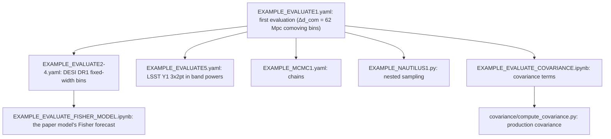

# Table of contents <a name="table_of_contents"></a>

1. [The DESI × LSST Y1 forecast](#forecast)
2. [Reading path through the examples](#reading_path)
3. [Running Cosmolike projects (Basic instructions)](#running_cosmolike_projects)
4. [The DESI DR1 fixed-width Δz cases](#dz_cases)
5. [The LSST Y1 3×2pt case](#lsst_case)
6. [The one-loop bias model](#higher_order_bias)
7. [Baryonic feedback on EXAMPLE_EVALUATE1](#baryonic_feedback)
8. [Nested sampling with Nautilus](#nautilus)
9. [Running Fisher](#fisher)
10. [Unit tests](#unit_tests)
11. [Computing covariances](#computing_covariances)
12. [Exploring notebooks](#notebooks)
13. [Appendix: Which accuracy settings are available?](#accuracy)

# The DESI × LSST Y1 forecast <a name="forecast"></a>

This project forecasts DESI spectroscopic galaxy clustering joint
with LSST Y1 cosmic shear in Fourier band powers: angular clustering
in thin tomographic bins, not a 3D power-spectrum analysis. The
reference layout:

- 76 lens bins of equal comoving width, about 62.3 Mpc - the layout
  $`\Delta d_\mathrm{com} = 62`$ Mpc, $`d_\mathrm{com}`$ the comoving
  distance; samples BGS, LRG1-3, ELG1-2; mean redshifts 0.11 to 1.55
  (`data/lssty1xdesi_desi_dr3_bins.txt` and `..._ngal.txt`);
- 15 shear pairs, 76 clustering autos and 107 cross-bin pairs, each in
  53 bands of width $`\Delta\ell = 10`$ over $`15 \le \ell \le 544`$:
  10,494 entries, 5,674 unmasked; no galaxy-galaxy lensing rows
  (`ggl_exclude: all`);
- the cross pairs are the 97 the DESI forecast measures plus 10
  LRG3 x ELG1 pairs with overlapping kernels (`scripts/make_desi_pairs.py`;
  [the cross-correlation note](notes/cross_correlations/cross_correlations.pdf)).

Each DESI data vector is a model at the fiducial point, not a
measurement. `data/lssty1xdesi_desi_<case>.dataset`, read by
`EXAMPLE_EVALUATE1.yaml` to `EXAMPLE_EVALUATE4.yaml`, holds the paper
model ([one-loop bias](#higher_order_bias)), so those examples
evaluate to $`\chi^2 \approx 0`$; `..._linear.dataset` holds the
growth-tied linear bias instead, and every example in
[exploration/](exploration/README.md) reads it.
`scripts/make_desi_fiducial.py` writes either vector from its example
(`<case>` = `dr3` for $`\Delta d_\mathrm{com} = 62`$ Mpc, `dr1_dz0p02`,
`dr1_dz0p05`, `dr1_dz0p20`).

The thin bins are the project's defining numerical challenge. The
likelihood computes the full density-density term with the low-rank
non-Limber engine (`adopt_limber_gg: 0`, `nonlimber_lowrank_gg: 1`)
and rebuilds the 76 lens distributions through the Fingers-of-God
convolution at every evaluation (`external_nz_modeling: 1`); the
[appendix](#accuracy) lists the accuracy settings this takes.

The bins share their nuisance parameters by sample: one linear bias
per sample group (`DESI_B1_*`) and seven sampled velocity dispersions
(`DESI_SIGV_*`, BGS split in two). `likelihood/desi_cl.py` scores the
band-power vector; the `combo_*` variants expose the probe subsets.
The survey inputs are ported from the sacc file of the source
forecast, a DESI DR3-like × LSST Y1 forecast
([the covariance guide](covariance/README.md#source_forecast)).

# Reading path through the examples <a name="reading_path"></a>

Start with one evaluation of `EXAMPLE_EVALUATE1.yaml`
([basic instructions](#running_cosmolike_projects)): it checks the
installation that every later example uses.



- `EXAMPLE_EVALUATE1.yaml` evaluates the fiducial point of the
  $`\Delta d_\mathrm{com} = 62`$ Mpc comoving binning with the paper
  model ([one-loop bias](#higher_order_bias)); a commented
  `bfmt` theory block shows how to turn each baryonic-feedback model on
  ([baryonic feedback](#baryonic_feedback)).
- `EXAMPLE_EVALUATE2.yaml` to `EXAMPLE_EVALUATE4.yaml` evaluate the
  DESI DR1 binnings of fixed width in redshift with the same model, and
  `EXAMPLE_EVALUATE5.yaml` the LSST Y1 3×2pt case
  ([Δz cases](#dz_cases), [LSST case](#lsst_case)).
- [exploration/](exploration/README.md) holds the examples of the other
  bias models, on the linear data vectors: the growth-tied linear bias
  (`EXAMPLE_EVALUATE_LINEAR1.yaml` to `EXAMPLE_EVALUATE_LINEAR4.yaml`),
  model A, and model B on the growth-tied linear bias.
- `EXAMPLE_MCMC1.yaml` samples the paper model on the
  $`\Delta d_\mathrm{com} = 62`$ Mpc layout, from the Fisher proposal
  covariance `EXAMPLE_MCMC1.covmat`.
- `EXAMPLE_NAUTILUS1.py` runs the Nautilus nested sampler on the model
  of `EXAMPLE_EVALUATE1.yaml` ([Nautilus](#nautilus)). The linear-bias
  MCMC is in [exploration/](exploration/README.md).
- `EXAMPLE_EVALUATE_FISHER_MODEL.ipynb` forecasts the paper model on
  every DESI layout; the linear-bias Fisher notebooks run on the
  exploration examples ([running Fisher](#fisher)).
- The covariance notebook and the production CLI need the optional
  covariance build ([computing covariances](#computing_covariances)).
- [tests/](tests/README.md) checks the predictions against stored
  references ([unit tests](#unit_tests)).

# Running Cosmolike projects (Basic instructions) <a name="running_cosmolike_projects"></a>

From `Cocoa/Readme` instructions:

> [!Note]
> `setup_cocoa.sh` and `compile_cocoa.sh` install and compile the cosmolike projects selected in `set_installation_options.sh`. A commented `IGNORE_COSMOLIKE_*_CODE` key enables a project; an active key skips it. This project ships skipped: comment out its key before running the two scripts.
>
>     [Adapted from Cocoa/set_installation_options.sh shell script]
>     (...)
>     # WARNING: lssty1xdesi is under active development.
>     export IGNORE_COSMOLIKE_LSSTY1XDESI_CODE=1
>     (...)
>     export LSSTY1XDESI_URL="https://github.com/SBU-COSMOLIKE/lssty1xdesi.git"
>     export LSSTY1XDESI_NAME="lssty1xdesi"
>     export LSSTY1XDESI_GIT_BRANCH="main"
>
> To select another revision, set only one of the project's `GIT_COMMIT`, `GIT_BRANCH` or `GIT_TAG` keys (here `LSSTY1XDESI_GIT_COMMIT`, `LSSTY1XDESI_GIT_BRANCH` or `LSSTY1XDESI_GIT_TAG`): a commit takes precedence over a branch, and a branch over a tag.

> [!NOTE]
> If users want to recompile cosmolike, there is no need to rerun the Cocoa general scripts. Instead, run the following three commands:
>
>      source start_cocoa.sh
>
> and
>
>      source ./installation_scripts/setup_cosmolike_projects.sh
>
> and
>
>       source ./installation_scripts/compile_all_projects.sh
>
> or (in case users just want to compile this project)
>
>       source ./projects/lssty1xdesi/scripts/compile_lssty1xdesi.sh

> [!TIP]
> Assuming Cocoa is installed on a local (not remote!) machine, type the command below after step 2️⃣ to run Jupyter Notebooks.
>
>     jupyter notebook --no-browser --port=8888
>
> The terminal will then show a message similar to the following template:
>
>     (...)
>     [... NotebookApp] Jupyter Notebook 6.1.1 is running at:
>     [... NotebookApp] http://f0a13949f6b5:8888/?token=XXX
>     [... NotebookApp] or http://127.0.0.1:8888/?token=XXX
>     [... NotebookApp] Use Control-C to stop this server and shut down all kernels (twice to skip confirmation).
>
> Now go to the local internet browser and type `http://127.0.0.1:8888/?token=XXX`, where XXX is the previously saved token displayed on the line
>
>     [... NotebookApp] or http://127.0.0.1:8888/?token=XXX
>
> The project contains jupyter notebook examples located at `projects/lssty1xdesi`.

> [!NOTE]
> The example notebooks load their shared support functions from
> `Cocoa/external_modules/code/cosmolike_core/cosmolike_notebook_utils/`,
> called through the `cnu` namespace: the CAMB run packaged for
> cosmolike, the data-vector helpers, and the Fisher-forecast helpers.
> What is specific to this project lives in
> `interface/cosmolike_lssty1xdesi_fisher.py` (the `ModelFisher` class
> of the [Fisher examples](#fisher)).

To run the example

 **Step :one:**: activate the Cocoa Conda environment,  and the private Python environment

      conda activate cocoa

and

      source start_cocoa.sh

 **Step :two:**: Select the number of OpenMP cores (the commands below set it to 8).

  - Linux

        export OMP_NUM_THREADS=8; export OMP_PROC_BIND=close; \
        export OMP_PLACES=cores; export OMP_DYNAMIC=FALSE; \
        export OPENBLAS_NUM_THREADS=1; export MKL_NUM_THREADS=1

  - macOS (arm)

        export OMP_NUM_THREADS=8; export OMP_PROC_BIND=disabled; \
        export OMP_PLACES=cores; export OMP_DYNAMIC=FALSE; \
        export OPENBLAS_NUM_THREADS=1; export MKL_NUM_THREADS=1

 **Step :three:**: The folder `projects/lssty1xdesi` contains examples. So, run the `cobaya-run` on the first example following the commands below.

> [!Warning]
> (Linux only) In some HPC nodes, `numa` can cause you problems. If that is the case,
> replace `numa` with `slot`

- **One model evaluation**:

  - Linux

        "${CONDA_PREFIX}"/bin/mpirun -n 1 --oversubscribe --mca pml ob1 --mca btl vader,tcp,self \
          --bind-to core:overload-allowed --report-bindings \
          --rank-by slot --map-by numa:pe=${OMP_NUM_THREADS} \
          cobaya-run ./projects/lssty1xdesi/EXAMPLE_EVALUATE1.yaml -f

  - macOS (arm)

        mpirun -n 1 --oversubscribe \
          cobaya-run ./projects/lssty1xdesi/EXAMPLE_EVALUATE1.yaml -f

> [!NOTE]
> One evaluation of `EXAMPLE_EVALUATE1.yaml` takes about 40 s of
> start-up, most of it inverting the covariance, and then about 11 s
> per evaluated point (measured on an Apple M2 Pro laptop on AC power
> with 8 OpenMP threads).

- **MCMC (Metropolis-Hastings Algorithm)**:

  - Linux

        "${CONDA_PREFIX}"/bin/mpirun -n 4 --oversubscribe --mca pml ob1 --mca btl vader,tcp,self \
          --bind-to core:overload-allowed --report-bindings \
          --rank-by slot --map-by numa:pe=${OMP_NUM_THREADS} \
          cobaya-run ./projects/lssty1xdesi/EXAMPLE_MCMC1.yaml -f

  - macOS (arm)

        mpirun -n 4 --oversubscribe \
          cobaya-run ./projects/lssty1xdesi/EXAMPLE_MCMC1.yaml -f

# The DESI DR1 fixed-width Δz cases <a name="dz_cases"></a>

The DESI DR1 forecast distributions split BGS, LRG and ELG into bins
of fixed width $`\Delta z`$ in redshift instead of fixed comoving
width. Three widths are separate cases of the same likelihood, each
with its own data files (`data/lssty1xdesi_desi_dr1_dz0pXX*`),
likelihood classes (`likelihood/desi_cl_dr1_dz0pXX[_model_b].py`),
parameter files and EXAMPLE yaml (the paper model; the linear one is
`exploration/EXAMPLE_EVALUATE_LINEAR<N>.yaml`, same number):

| Case | $`\Delta z`$ | Lens bins | Cross pairs | Entries | Unmasked | `accuracyboost` | `nonlimber_accuracyboost` | EXAMPLE |
|---|---:|---:|---:|---:|---:|---:|---:|---|
| `dr1_dz0p20` | 0.2 | 10 | 13 | 2,014 | 744 | 2 | 4 | `EXAMPLE_EVALUATE4.yaml` |
| `dr1_dz0p05` | 0.05 | 36 | 52 | 5,459 | 2,982 | 2 | 16 | `EXAMPLE_EVALUATE3.yaml` |
| `dr1_dz0p02` | 0.02 | 90 | 133 | 12,614 | 7,621 | 2 | 32 | `EXAMPLE_EVALUATE2.yaml` |

The distributions come without bandpowers, pairs or scale cuts, so
`scripts/make_desi_dz_case.py` builds them with the conventions of the
$`\Delta d_\mathrm{com} = 62`$ Mpc sacc file. Its docstring states
each rule; in short:

- **bands**: the 53 bands of the $`\Delta d_\mathrm{com} = 62`$ Mpc
  sacc;
- **cross pairs**: every two bins whose distributions overlap or
  touch;
- **scale cuts**: an auto spectrum keeps the bands with
  $`\ell + 1/2 \le k_\mathrm{max}\,\chi(\bar z)`$, with
  $`k_\mathrm{max} = 0.1185\ \mathrm{Mpc}^{-1}`$, $`\chi`$ the comoving
  distance and $`\bar z`$ the bin's mean redshift; a cross pair keeps
  the bands both of its autos keep;
- **densities**: only the per-bin `ngal` of the forecast's
  `probes_properties` files is used. Their other entries are not
  current.

Narrower bins need a finer non-Limber grid along the line of sight.
Each case's likelihood yaml sets the `accuracyboost` and
`nonlimber_accuracyboost` of the table above and records the measured
$`\Delta\chi^2`$ ladder behind them ([appendix](#accuracy)).

The covariance of each case is the Gaussian term at 14,000 deg²,
stored sparse in the cosmolike text format. Like every covariance
under `data/`, it is built locally and not tracked by git;
`tests/frozen/data/` keeps a snapshot.

A case is rebuilt in four steps, shown here for $`\Delta z = 0.02`$.
`--input-dir` names the folder of the DR1 distribution files, which
are not distributed with the project; step two needs the covariance
interface compiled ([covariance guide](covariance/README.md)).

**Step :one:**: build the case's data files.

```bash
python ./projects/lssty1xdesi/scripts/make_desi_dz_case.py --width 0.02 --stage files --input-dir /path/to/dr1_inputs
```

**Step :two:**: compute the case's Gaussian covariance.

```bash
python ./projects/lssty1xdesi/covariance/compute_covariance.py ./projects/lssty1xdesi/EXAMPLE_EVALUATE_COVARIANCE2.yaml
```

**Step :three:**: install the covariance into the case's data files.

```bash
python ./projects/lssty1xdesi/scripts/make_desi_dz_case.py --width 0.02 --stage covariance
```

**Step :four:**: write the fiducial data vectors.

```bash
python ./projects/lssty1xdesi/scripts/make_desi_dz_case.py --width 0.02 --stage fiducial
```

The last step writes each example's model vector at its fiducial as
its dataset's data vector (`scripts/make_desi_fiducial.py`), so each
example evaluates to $`\chi^2 \approx 0`$. The paper example
`EXAMPLE_EVALUATE<N>.yaml` is written by hand for a new case.

# The LSST Y1 3×2pt case <a name="lsst_case"></a>

`EXAMPLE_EVALUATE5.yaml` evaluates LSST Y1 alone: cosmic shear,
galaxy-galaxy lensing and clustering in band powers on the same 53
bands, so its Fisher matrix can add to a DESI case's. The
distributions are the lsst_y1 project's (`data/lssty1xdesi_lens.nz`,
`..._source.nz`, five bins each; the z column is the lower bin edge).
The likelihood `likelihood/lsst_y1_3x2pt.py` is `combo_3x2pt` in
Fourier space: FKEM non-Limber clustering and lensing below
$`\ell = 150`$.

| Block | Spectra | Entries | Kept by the mask |
|---|---:|---:|---|
| cosmic shear | 15 | 795 | every band |
| galaxy-galaxy lensing | 25 | 1,325 | the lens bin's clustering cut |
| clustering | 5 | 265 | $`\ell + 1/2 \le k_\mathrm{max}\,\chi(\bar z)`$ |

That leaves 1,629 unmasked entries out of 2,385.

The covariance is the Gaussian term at 12,300 deg², with the LSST Y1
science-requirements densities and shape noise and with
nonlinear-alignment intrinsic alignments in the shear signals
([covariance guide](covariance/README.md#survey)).
`scripts/make_lsst_3x2pt_case.py` builds the case with the four steps
of the Δz builder, on `EXAMPLE_EVALUATE_COVARIANCE5.yaml`.

# The one-loop bias model <a name="higher_order_bias"></a>

The likelihood option `higher_order_bias: 1` switches on the one-loop
galaxy-bias model of
[the higher-order bias note](notes/higher_order_bias/higher_order_bias.pdf)
on every DESI layout; `higher_order_bias: 0` is linear bias. The model
keeps the per-bin linear bias $`b_{1,i}`$ of the linear examples, with
$`i`$ the lens bin, and adds per bin:

- the quadratic bias $`b_{2,i}`$ of the Lazeyras et al. relation on
  $`b_{1,i}`$ (arXiv:1511.01096) and the co-evolution tidal bias
  $`b_{s^2,i} = -\tfrac{4}{7}(b_{1,i} - 1)`$, each plus a free offset;
- the counterterm $`\alpha_0 k^2 P_\mathrm{NL}`$;
- the radial counterterm $`\alpha_2`$ in the DESI DR1 convention
  (arXiv:2404.07312): the redshift-space galaxy power gains
  $`(b_{1,i} + f\mu^2)\,f\alpha_2\,\mu^2 k^2 P_\mathrm{lin}`$;
- a white-noise power $`\mathrm{SN}_0`$;
- the line-of-sight stochastic power $`\mathrm{SN}_2\,k^2\mu^2`$.

Here $`k`$ is the wavenumber, $`\mu`$ the cosine between the
wavevector and the line of sight, $`f`$ the linear growth rate, and
$`P_\mathrm{lin}`$ and $`P_\mathrm{NL}`$ the linear and nonlinear
matter power spectra; the third-order bias $`b_{3\mathrm{nl}}`$ is 0.
Zero amplitudes switch a term off at no cost per evaluation.
[The higher-order bias note](notes/higher_order_bias/higher_order_bias.pdf)
derives the model, its thin-bin projections and why
$`\mathrm{SN}_2`$ is required.

Models A and B of the note are parameter files of this one option;
both live in [exploration/](exploration/README.md). **Model A**, for
$`k_\mathrm{max} = 0.075\,h\,\mathrm{Mpc}^{-1}`$, fixes $`\alpha_2 = 0`$.
**Model B**, for the shipped masks ($`k = 0.1185\ \mathrm{Mpc}^{-1}`$
$`\approx 0.176\,h\,\mathrm{Mpc}^{-1}`$ in every bin), frees
$`\alpha_2`$ and widens the offset priors to the DESI DR1 widths.

**The paper model** is model B + tilts with $`\alpha_2`$ fixed to 0 in
every bin: $`\alpha_2`$ is about 99% degenerate with the velocity
dispersions $`\sigma_v`$
([the FoG degeneracy note](notes/fog_parameter_degeneracy_study/fog_parameter_degeneracy_study.pdf)).
In exchange, every $`\sigma_v`$ prior is widened by a factor 6
(`PAPER_SIGV_WIDTH_FACTOR` in `scripts/make_desi_params.py`), wide
enough to absorb an $`\alpha_2`$ of the DESI DR1 prior size. The
widened priors are truncated normals (truncated at zero), one sampled
leader per velocity-dispersion group:

| Group | Fiducial $`\sigma_v`$ [km/s] | Prior width [km/s] |
|---|---:|---:|
| BGS, $`\bar z < 0.255`$ | 371 | 870 |
| BGS, $`\bar z \ge 0.255`$ | 358 | 630 |
| LRG1 | 357 | 420 |
| LRG2 | 348 | 300 |
| LRG3 | 343 | 300 |
| ELG1 | 304 | 240 |
| ELG2 | 289 | 180 |

The likelihood reads one value per bin (`DESI_A2_<n>` and so on, with
$`n`$ counting the bins from 1); the parameter files tie the bins of a
sample group $`g`$ (BGS, LRG1-3, ELG1-2) to one sampled offset per
group, and "+ tilts" adds to each offset a free straight line in
redshift per group. The paper model's parameters, every offset prior a
Gaussian centered on zero:

| Parameter | Meaning | Unit | Prior |
|---|---|---|---|
| `DESI_DB2_<g>`, `DESI_TB2_<g>` | offset of $`b_2`$ from the Lazeyras relation, and its tilt | none | width 2.0; tilt flat |
| `DESI_DBS_<g>`, `DESI_TBS_<g>` | offset of $`b_{s^2}`$ from co-evolution, and its tilt | none | width 1.0; tilt flat |
| `DESI_A0_<g>`, `DESI_TA0_<g>` | counterterm $`\alpha_0`$, and its tilt | $`h^{-2}\,\mathrm{Mpc}^2`$ | width 16.1; tilt flat |
| `DESI_A2_<n>` | radial counterterm $`\alpha_2`$ | $`h^{-2}\,\mathrm{Mpc}^2`$ | fixed to 0 |
| `DESI_SN0_<g>` | white noise $`\mathrm{SN}_0`$ | $`1/\bar n_i`$ | width 2 |
| `DESI_SN2_<g>` | line-of-sight noise $`\mathrm{SN}_2`$ | $`f_\mathrm{sat}\sigma_\mathrm{sat}^2/\bar n_i`$ | width 5 |

The $`\alpha_0`$ width is the DESI rule $`0.5/k_\mathrm{max}^2 = 16.1`$
at the mask's $`0.176\,h\,\mathrm{Mpc}^{-1}`$ (model A: 88.9 at
$`0.075`$). The stochastic amplitudes never tilt. In the units,
$`\bar n_i`$ is the bin's number density ($`1/\bar n_i`$ its Poisson
power), $`f_\mathrm{sat}`$ the satellite fraction and
$`\sigma_\mathrm{sat}`$ the satellites' dispersion in
$`h^{-1}\,\mathrm{Mpc}`$, not the sampled $`\sigma_v`$: 0.1 and 7.8
for BGS and LRG, 0.1 and 2.9 for ELG.

The paper model runs on the pessimistic linear-bias prior. Each layout
has one likelihood class and one example of it:

| Layout | Example | Likelihood class |
|---|---|---|
| $`\Delta d_\mathrm{com} = 62`$ Mpc | `EXAMPLE_EVALUATE1.yaml` | `desi_cl_model_b` |
| $`\Delta z = 0.02`$ | `EXAMPLE_EVALUATE2.yaml` | `desi_cl_dr1_dz0p02_model_b` |
| $`\Delta z = 0.05`$ | `EXAMPLE_EVALUATE3.yaml` | `desi_cl_dr1_dz0p05_model_b` |
| $`\Delta z = 0.2`$ | `EXAMPLE_EVALUATE4.yaml` | `desi_cl_dr1_dz0p20_model_b` |

Each class sets `higher_order_bias: 1` and reads two parameter files
(cobaya takes a likelihood's parameters from its class):

- `likelihood/params_desi[_<case>]_model_b_tilts.yaml`, the one-loop
  fragment of the paper model: the offsets of $`b_2`$, $`b_{s^2}`$ and
  $`\alpha_0`$ with their tilts (`DESI_TB2_<g>`, `DESI_TBS_<g>`,
  `DESI_TA0_<g>`), the stochastic amplitudes without tilts, and
  $`\alpha_2`$ fixed to 0 in every bin.
- `likelihood/params_desi[_<case>]_bias_pessimistic.yaml`, the
  pessimistic linear-bias prior of
  [the correlated-prior note](notes/correlated_bias_prior_v2/correlated_bias_prior_v2.pdf):
  a free amplitude `DESI_B1_<g>` and tilt `DESI_TB1_<g>` per group,
  plus a correlated Gaussian residual of width 3% per bin
  (correlation length 0.05 in redshift, sampled as one unit Gaussian
  `DESI_UB1_<n>` per bin). It also carries the seven widened
  $`\sigma_v`$ priors of the table above.

The examples run as in the
[basic instructions](#running_cosmolike_projects), with every offset,
tilt and residual at zero, and evaluate to $`\chi^2 \approx 0`$
(1.0e-11, 1.1e-11, 4.1e-12 and 7.0e-13 in layout order).

The linear, model A and model B examples and classes are in
`likelihood/exploration/` and [exploration/](exploration/README.md).
`scripts/make_desi_params.py` writes the parameter files
(`--bias-pessimistic`, `--model-a` or `--model-b`, with
`--case <name>` for a $`\Delta z`$ layout).

# Baryonic feedback on EXAMPLE_EVALUATE1 <a name="baryonic_feedback"></a>

`EXAMPLE_EVALUATE1.yaml` can apply an external baryonic feedback
suppression to the matter power spectrum via the `bfmt` theory block
(SP(k), BCEmu, Flamingo, BACCOemu, or BCemu2025). By default, the
example runs without feedback.

**Step :one:**: ensure the lines below are commented out in
`set_installation_options.sh` before running `setup_cocoa.sh` and
`compile_cocoa.sh`. *By default, these lines should be commented out,
but it is worth checking*.

      [Adapted from Cocoa/set_installation_options.sh shell script]
      #export IGNORE_PYSPK_CODE=1
      #export IGNORE_BCEMU_CODE=1
      #export IGNORE_FBRE_CODE=1
      #export IGNORE_BACCOEMU_CODE=1
      (...)
      #export IGNORE_BFMT_CODE=1 # Baryon Feedback Theory Block from Nihar&JVicente

**Step :two:**: in `EXAMPLE_EVALUATE1.yaml`, uncomment the `bfmt`
theory block and select the model:

      theory:
        bfmt:
          baryon_model: 2 # 1 = SP(k), 2 = BCEmu, 3 = FlamingoEmulator, 4 = BACCOemu, 5 = BCemu2025

**Step :three:**: set `external_baryon_suppression: True` on the
`lssty1xdesi.desi_cl_model_b` likelihood block.

**Step :four:**: add the selected model's sampled parameters to the
`params` block and to the `sampler: evaluate: override` block.

> [!NOTE]
> BACCOemu (`baryon_model: 4`) rejects this example's fiducial
> `omegab: 0.04`, the edge of its baryon-density training box. Move
> `omegab` inside that box before selecting it.

> [!TIP]
> For the sampled parameters of each model, their validity ranges, and
> the `bfmt` options, see
> `Cocoa/external_modules/code/baryon_suppression/README.md`. The
> baryonic-feedback drift tests of the
> [test guide](tests/README.md) exercise every model against stored
> per-model vectors.

# Nested sampling with Nautilus <a name="nautilus"></a>

`EXAMPLE_NAUTILUS1.py` samples the model of `EXAMPLE_EVALUATE1.yaml`
(the paper model on the $`\Delta d_\mathrm{com} = 62`$ Mpc layout,
with CAMB) with the Nautilus nested sampler: Bayesian evidence and
weighted posterior samples. Every MPI rank builds its own model; the
model samples 151 parameters. A run that reaches `--maxfeval` stops
without convergence.

We assume Cocoa and this project are installed, the Cocoa Conda
environment is active, the shell is Bash, and the current folder is
`cocoa/Cocoa/`.

**Step :one:**: activate Cocoa.

```bash
source start_cocoa.sh
```

**Step :two:**: Select the number of OpenMP cores (below, we set it to 8).

  - Linux

        export OMP_NUM_THREADS=8; export OMP_PROC_BIND=close; \
        export OMP_PLACES=cores; export OMP_DYNAMIC=FALSE; \
        export OPENBLAS_NUM_THREADS=1; export MKL_NUM_THREADS=1

  - macOS (arm)

        export OMP_NUM_THREADS=8; export OMP_PROC_BIND=disabled; \
        export OMP_PLACES=cores; export OMP_DYNAMIC=FALSE; \
        export OPENBLAS_NUM_THREADS=1; export MKL_NUM_THREADS=1

**Step :three:**: check the setup before a long run. The check builds the
model, evaluates the fiducial point ($`\chi^2 \approx 10^{-11}`$) and builds
the Nautilus sampler, without sampling.

```bash
python ./projects/lssty1xdesi/EXAMPLE_NAUTILUS1.py --check
```

**Step :four:**: run Nautilus.

- Linux

      "${CONDA_PREFIX}"/bin/mpirun -n 90 --oversubscribe \
        --mca pml ob1 --mca btl vader,tcp,self \
        -x PATH -x LD_LIBRARY_PATH -x PYTHONPATH -x CONDA_PREFIX -x ROOTDIR \
        -x OMP_NUM_THREADS -x OMP_PROC_BIND -x OMP_PLACES -x OMP_DYNAMIC \
        -x OPENBLAS_NUM_THREADS -x MKL_NUM_THREADS -x CLIK_PATH -x CLIK_DATA \
        -x CLIK_PLUGIN --mca mpi_yield_when_idle 1 \
        --mca btl_tcp_if_exclude lo,docker0,virbr0,ib0 \
        --bind-to core:overload-allowed --report-bindings \
        --rank-by slot --map-by numa:pe=${OMP_NUM_THREADS} \
        python ./projects/lssty1xdesi/EXAMPLE_NAUTILUS1.py --nlive 1000 --neff 10000 --maxfeval 100000 --outroot nautilus1

- macOS (arm)

      mpirun -n 12 --oversubscribe \
        python ./projects/lssty1xdesi/EXAMPLE_NAUTILUS1.py --nlive 1000 --neff 10000 --maxfeval 100000 --outroot nautilus1

The results go to `projects/lssty1xdesi/chains/<outroot>.*`: weighted
GetDist-compatible rows and a JSON record of the run. An existing
result is never overwritten, so use a new `--outroot` for each run.

# Running Fisher <a name="fisher"></a>

The Fisher machinery is `interface/cosmolike_lssty1xdesi_fisher.py`
(`ModelFisher`): it builds the cobaya model of an EXAMPLE yaml and
differentiates exactly the data vector the likelihood scores.
[The Fisher-machinery note](notes/fisher_machinery/fisher_machinery.pdf)
explains the construction. Three notebooks use it:

- [EXAMPLE_EVALUATE_FISHER_MODEL.ipynb](EXAMPLE_EVALUATE_FISHER_MODEL.ipynb):
  the paper model's forecast ([below](#fisher_model)).
- [EXAMPLE_EVALUATE_FISHER.ipynb](EXAMPLE_EVALUATE_FISHER.ipynb):
  linear-bias forecasts of DESI clustering, LSST Y1 3×2pt and their
  combination on every layout (as independent data sets: no LSST×DESI
  cross spectra, no cross-covariance); the Fisher biases of the projection
  approximations (Limber, FKEM); the amplitude cut against the
  contours ([below](#amplitude_cut)).
- [EXAMPLE_EVALUATE_FISHER_LINEAR_KMAX.ipynb](EXAMPLE_EVALUATE_FISHER_LINEAR_KMAX.ipynb):
  linear-bias fits to one-loop truths against the scale cut
  $`k_\mathrm{max}`$, for the four linear-bias priors.

The two linear-bias notebooks run on the examples of
[exploration/](exploration/README.md). Each notebook's export cells
write its figures into the notes under [notes/](notes/);
[the summary note](notes/bias_model_summary/bias_model_summary.pdf)
presents the paper model's results.

> [!WARNING]
> The forecasts need CAMB installed with
> `PATCH_CAMB_HALOFIT_TOLERANCE` in `set_installation_options.sh`:
> stock halofit's $`10^{-3}`$ tolerance makes the data vectors jump
> between nearby cosmologies, so stencil derivatives depend on the
> step size.

## The paper model's forecast <a name="fisher_model"></a>

[EXAMPLE_EVALUATE_FISHER_MODEL.ipynb](EXAMPLE_EVALUATE_FISHER_MODEL.ipynb)
forecasts the paper model ([one-loop bias](#higher_order_bias)) on the
pessimistic linear-bias prior, built from the paper yamls
`EXAMPLE_EVALUATE1.yaml` to `EXAMPLE_EVALUATE4.yaml` on every DESI
layout. For the correlated-prior note it also forecasts model B and
model B + tilts on the three linear-bias priors against the scale cut.
In order, the notebook:

- computes the UV-fraction scale cuts on the paper model's fiducial
  (its section 3; [below](#scale_cut));
- builds the derivative base of each layout (section 4):
  five-point-stencil derivatives of the 20 sampled
  parameters, per-bin columns of $`b_1`$, $`b_2`$, $`b_{s^2}`$ and
  $`\alpha_0`$, and the exact templates of $`\alpha_2`$,
  $`\mathrm{SN}_0`$ and $`\mathrm{SN}_2`$;
- assembles every Fisher matrix at every cut from the base columns, the
  covariance of the kept entries (its inverse rescaled from
  14,000 deg² to 12,300 deg²) and the yaml priors, and prints the
  marginalized errors and figures of merit;
- computes linear-response shifts under truths the models do not
  sample, among them an $`\alpha_2`$ of the DESI DR1 prior size;
- writes figures and data into four notes' `plots/` folders:
  [correlated_bias_prior_v2](notes/correlated_bias_prior_v2)
  (fom_kmax_models, growth_tied_kmax),
  [bias_model_summary](notes/bias_model_summary) (the four summary_*
  folders), [fog_parameter_degeneracy_study](notes/fog_parameter_degeneracy_study)
  (the four fog_* folders) and
  [cross_correlations](notes/cross_correlations) (pair_threshold).

The derivative base costs 154 evaluations of the data vector per
layout and is cached. The working copies live in `chains/` (not
tracked by git); the final-tier copies are archived in
[fisher_caches/](fisher_caches/README.md) through Git LFS, so a fresh
clone copies them instead of recomputing. With `<layout>` one of
`dcom62` ($`\Delta d_\mathrm{com} = 62`$ Mpc), `dz0p02`, `dz0p05` and
`dz0p20` ($`\Delta z`$ = 0.02, 0.05, 0.2), the notebook keeps three
caches:

| Cache | Holds |
|---|---|
| `model_derivatives_<layout>_final.npz` | the stencil columns of the 20 sampled parameters, the per-bin columns of $`b_1`$, $`b_2`$, $`b_{s^2}`$ and $`\alpha_0`$, the $`\mathrm{SN}_0`$ templates and the fiducial vector |
| `model_templates_<layout>_final.npz` | the $`\alpha_2`$ columns and the $`\mathrm{SN}_0`$ and $`\mathrm{SN}_2`$ templates |
| `model_scale_cuts_final.npz` | the UV-fraction scale cuts on the paper fiducial |

Copying from the archive, reading, computing, writing and archiving
are each an explicit call in its own cell. A cache whose settings or
fingerprint (the sha256 of the resolved model input) differ from the
notebook's is refused, and no file is replaced without
`overwrite=True`. Fisher matrices are never cached: every run rebuilds
them from the base and the current covariance files. The two
derivative caches can also be computed on many cores
([MPI](#fisher_mpi)).

The DESI covariance is built on the one-loop model at its fiducial, so
the data vector and its covariance share one model
([the covariance guide](covariance/README.md#gaussian)).

## The scale cut <a name="scale_cut"></a>

Every Fisher fit applies the non-Limber UV-fraction scale cut
(arXiv:2603.13031) on top of the shipped masks: a band is kept while
the fraction of $`C_\ell`$ sourced by the modes
$`k > k_\mathrm{max}/D(z)`$ stays below 0.05, with $`D`$ the linear
growth factor ($`D(0) = 1`$) and $`k_\mathrm{max}`$ quoted in
$`h\,\mathrm{Mpc}^{-1}`$ at $`z = 0`$.
[The correlated-prior note](notes/correlated_bias_prior_v2/correlated_bias_prior_v2.pdf)
explains the criterion.

The cut depends on the spectra it splits: the paper notebook computes
it on the paper model's fiducial, the linear-bias notebooks on the
linear-bias fiducial.
[The scale-cut note](notes/scale_cut_fiducial_dependence/scale_cut_fiducial_dependence.pdf)
compares the two: the difference moves the figures of merit by at most
a few percent.

## The amplitude cut <a name="amplitude_cut"></a>

Every example that samples linear biases carries the cobaya prior
`amplitude_cut`: the clustering-amplitude ratio
$`A_s b_i^2/(A_s b_i^2)_\mathrm{fid}`$ is capped at 8 per group, with
$`A_s`$ the primordial amplitude (sampled as `As_1e9` $`= 10^9 A_s`$)
and $`b_i`$ a bin's linear galaxy bias. The cap, the common cut of the
cosmolike projects, bounds the numerical error of the data vector,
which grows with that ratio
([the data-vector tests](tests/data_vector/README.md#nmodels_check)).
The LSST Y1 3×2pt example applies the same cut to its lens biases.

Section 8 of [EXAMPLE_EVALUATE_FISHER.ipynb](EXAMPLE_EVALUATE_FISHER.ipynb)
draws, for every DESI layout, the region the cut excludes and the
cosmological prior walls ($`\Omega_m \in [0.2, 0.5]`$,
$`w_0 \le -1/3`$, $`-3 \le w_0 + w_a \le -0.01`$) against the forecast
contours.

## Computing the derivative base with MPI <a name="fisher_mpi"></a>

`scripts/compute_fisher_base_mpi.py` computes the derivative base of
one layout on $`N`$ MPI ranks times $`T`$ OpenMP threads and writes
the working copies of the two derivative caches of the table above
(the scale-cut cache is the notebook's own), equal to the serial
notebook's; archiving them stays the notebook's
`fm.save_fisher_to_cache` cell. The script's docstring holds the cache
rules and the parallel layout; `--dry-run` prints the plan without
building a model, and an existing cache is never replaced without
`--overwrite`.

Each rank builds its own cobaya model, covariance included. On
$`\Delta d_\mathrm{com} = 62`$ Mpc a rank pays about 40 s of start-up,
takes about 41 s per evaluation and peaks near 13.6 GB of memory, so
12 ranks on a 96-core node need about 165 GB. Measured on
$`\Delta z = 0.2`$:

| Ranks × threads | Wall time | Evaluations per minute |
|---:|---:|---:|
| 1 × 8 | 1884 s | 4.9 |
| 2 × 4 | 1539 s | 6.0 |
| 4 × 2 | 1423 s | 6.5 |

The 1 × 8 and 2 × 4 runs reproduce the serial notebook's caches bit
for bit; the 4 × 2 run moves one stencil column by a relative
$`10^{-13}`$, because its ranks evaluate the points in a different
order.

**Step :one:**: activate the Cocoa Conda environment, and the private
Python environment

      conda activate cocoa

and

      source start_cocoa.sh

**Step :two:**: Select the number of OpenMP threads per rank (the
commands below set it to 8). `--threads-per-rank` must match it; the
script sets the BLAS libraries to one thread by itself.

  - Linux

        export OMP_NUM_THREADS=8; export OMP_PROC_BIND=close; \
        export OMP_PLACES=cores; export OMP_DYNAMIC=FALSE; \
        export OPENBLAS_NUM_THREADS=1; export MKL_NUM_THREADS=1

  - macOS (arm)

        export OMP_NUM_THREADS=8; export OMP_PROC_BIND=disabled; \
        export OMP_PLACES=cores; export OMP_DYNAMIC=FALSE; \
        export OPENBLAS_NUM_THREADS=1; export MKL_NUM_THREADS=1

**Step :three:**: preview the split; `--dry-run N` plans for $`N`$
ranks and computes nothing. `--layout` is one of `dcom62`, `dz0p02`,
`dz0p05` and `dz0p20`.

```bash
python ./projects/lssty1xdesi/scripts/compute_fisher_base_mpi.py \
  --layout dz0p20 --dry-run 2
```

**Step :four:**: launch.

  - Linux (one 96-core node, 12 ranks × 8 threads)

        "${CONDA_PREFIX}"/bin/mpirun -n 12 --oversubscribe \
          --mca pml ob1 --mca btl vader,tcp,self \
          --bind-to core:overload-allowed --report-bindings \
          --rank-by slot --map-by numa:pe=${OMP_NUM_THREADS} \
          python ./projects/lssty1xdesi/scripts/compute_fisher_base_mpi.py \
            --layout dcom62 --threads-per-rank ${OMP_NUM_THREADS}

  - macOS (arm) (laptop, 2 ranks × 4 threads)

        mpirun -n 2 --oversubscribe \
          python ./projects/lssty1xdesi/scripts/compute_fisher_base_mpi.py \
            --layout dz0p20 --threads-per-rank 4

> [!NOTE]
> **Running on more than one node.**
>
> 1. **Network interface.** TCP must use an interface routable between
>    compute nodes. A common exclusion list is
>    `--mca btl_tcp_if_exclude lo,docker0,virbr0,ib0`; adapt it to the
>    cluster. Keep `ib0` if routable IP-over-InfiniBand is the intended
>    network. The ranks exchange data vectors and scalar checks, so
>    communication volume is small.
> 2. **Environment.** Remote ranks need the same Cocoa paths and
>    libraries: `ROOTDIR`, `PATH`, `LD_LIBRARY_PATH`, `PYTHONPATH`,
>    `CONDA_PREFIX`, and the OpenMP settings. Slurm normally exports
>    the submitting environment (`--export=ALL`); explicit `-x` options
>    also forward these variables with SSH launchers. Activate Cocoa
>    before launching; all nodes must see the same files at the same
>    paths.
> 3. **Slurm geometry.** Keep `ntasks-per-node × cpus-per-task` within
>    the allocated physical cores per node, set `OMP_NUM_THREADS` to
>    `SLURM_CPUS_PER_TASK` and use
>    `--map-by numa:pe=${OMP_NUM_THREADS}`. Each rank holds a complete
>    model in memory, so the per-rank peak above also bounds the ranks
>    per node.

# Unit tests <a name="unit_tests"></a>

The `tests/` folder compares likelihood predictions against stored
reference values, checks for race conditions from OpenMP threading,
and measures the numerical error of the default accuracy settings,
including the project's own non-Limber controls: the low-rank engine
switches, the FKEM comparison at an equal multipole cap on the four
DESI layouts, the chi-grid ladder, the photo-z conventions and the
cache ladder. [tests/README.md](tests/README.md) describes the checks,
how to run them, the input data snapshots, and how to refresh them.

# Computing covariances <a name="computing_covariances"></a>

The covariance tools compute Gaussian (G), super-sample (SSC),
connected non-Gaussian (cNG) and total matrices before scale cuts; the
Gaussian term carries the lens redshift-space distortions and the
non-Limber recompute of the low multipoles.
[covariance/README.md](covariance/README.md) explains compilation, the
production CLI, the `EXAMPLE_EVALUATE_COVARIANCE.ipynb` notebook,
accuracy settings, output files, and the entry-by-entry comparison
against the source forecast's covariance.

# Exploring notebooks <a name="notebooks"></a>

**Armadillo** was chosen to make a convenient Python API for notebook
exploration. This C++ library provides vectors, matrices and
three-dimensional arrays called cubes. A small interface layer
connects them to NumPy through **pybind11**, with **CARMA** handling
array conversion. The notebooks expose intermediate quantities;
production calculations use the CLI interfaces.

We assume Cocoa and this project are installed, the Cocoa Conda
environment is active, the shell is Bash, and the current folder is
`cocoa/Cocoa/`.

Compile the project first; the covariance notebook also needs the
optional covariance build described
[above](#computing_covariances).

**Step :one:**: activate Cocoa.

```bash
source start_cocoa.sh
```

**Step :two:**: Select the number of OpenMP cores (below, we set it to 8).

  - Linux

        export OMP_NUM_THREADS=8; export OMP_PROC_BIND=close; \
        export OMP_PLACES=cores; export OMP_DYNAMIC=FALSE; \
        export OPENBLAS_NUM_THREADS=1; export MKL_NUM_THREADS=1

  - macOS (arm)

        export OMP_NUM_THREADS=8; export OMP_PROC_BIND=disabled; \
        export OMP_PLACES=cores; export OMP_DYNAMIC=FALSE; \
        export OPENBLAS_NUM_THREADS=1; export MKL_NUM_THREADS=1

**Step :three:**: start Jupyter.

```bash
jupyter notebook --no-browser --port=8888
```

**Step :four:**: open the printed URL and choose a notebook below.

**Step :five:**: select **Kernel → Restart Kernel and Run All Cells**.

| Notebook | Contents |
|---|---|
| [EXAMPLE_EVALUATE_COVARIANCE.ipynb](EXAMPLE_EVALUATE_COVARIANCE.ipynb) | The covariance terms of the $`\Delta d_\mathrm{com} = 62`$ Mpc layout and matrix diagnostics; needs the covariance build ([covariance guide](covariance/README.md#running)). |
| [EXAMPLE_EVALUATE_FISHER.ipynb](EXAMPLE_EVALUATE_FISHER.ipynb) | Linear-bias Fisher forecasts of DESI clustering, LSST Y1 3×2pt and their combination on every DESI layout, the Fisher biases of the projection approximations, and the amplitude cut against the forecast contours ([running Fisher](#fisher)). |
| [EXAMPLE_EVALUATE_FISHER_LINEAR_KMAX.ipynb](EXAMPLE_EVALUATE_FISHER_LINEAR_KMAX.ipynb) | Linear-bias fits to one-loop truths against the scale cut $`k_\mathrm{max}`$, for the four linear-bias priors ([running Fisher](#fisher)). |
| [EXAMPLE_EVALUATE_FISHER_MODEL.ipynb](EXAMPLE_EVALUATE_FISHER_MODEL.ipynb) | The paper model's Fisher forecast on every DESI layout, against the scale cut ([the paper model's forecast](#fisher_model)). |

Choose the Python kernel from the activated Cocoa environment and
restart it after recompiling.

# Appendix <a name="appendix"></a>

## FAQ: Which accuracy settings are available? <a name="accuracy"></a>

Data-vector options belong to the selected `likelihood` block.
Covariance options belong to the covariance yaml and are documented in
the [covariance guide](covariance/README.md#accuracy-settings); the
two sets are separate, and changing one does not refine the other.

| Data-vector setting | What it changes |
|---|---|
| `accuracyboost` | Overall interpolation-table resolution; it also multiplies the non-Limber chi grid below. |
| `internal_accuracyboost` | C-FAST-PT convolution grid. |
| `nonlimber_accuracyboost` | Non-Limber line-of-sight (chi) sampling. |
| `integration_accuracy` | Quadrature resolution of the Limber integrals. |
| `pk_z_refinement` | Nested redshift refinement of matter-power inputs. |
| `lmax` | Angular-transform table bound; in Fourier mode it only bounds `nonlimber_lowrank_lmax` from above. |
| `kmax_boltzmann` | Requested Boltzmann power range; coordinate it with the theory settings. |

The non-Limber chi grid is log-spaced with
$`N_{\chi} - 1 = 511\,m`$ nodes, where $`m`$ is the product of
`accuracyboost` and `nonlimber_accuracyboost` rounded up to a power of
two: the grid refines by nested interval doubling, so consecutive
settings reuse the same nodes. The log spacing makes the
highest-redshift thin bins the narrowest in $`\ln\chi`$, which is why
the thin layouts need large combined factors. The reference settings
of the shipped EXAMPLEs are:

| EXAMPLE | Layout | `accuracyboost` | `nonlimber_accuracyboost` | `kmax_boltzmann` |
|---|---|---:|---:|---:|
| `EXAMPLE_EVALUATE1.yaml` | $`\Delta d_\mathrm{com} = 62`$ Mpc bins | 2 | 32 | 20 |
| `EXAMPLE_EVALUATE2.yaml` | DR1, $`\Delta z = 0.02`$ | 2 | 32 | 20 |
| `EXAMPLE_EVALUATE3.yaml` | DR1, $`\Delta z = 0.05`$ | 2 | 16 | 20 |
| `EXAMPLE_EVALUATE4.yaml` | DR1, $`\Delta z = 0.2`$ | 2 | 4 | 20 |

With `kmax_boltzmann: 20` and `accuracyboost: 2`, CAMB tabulates the
matter power up to `kmax_boltzmann` $`\times`$ `accuracyboost`
$`= 40\ \mathrm{Mpc}^{-1}`$; past the table the power is
extrapolated. The range protects the prior corners rather than the
fiducial: at a low-$`\Omega_m`$ point ($`\Omega_m = 0.237`$,
$`w_0 = -2.39`$, $`w_0 + w_a = -2.87`$,
$`H_0 = 78.6\ \mathrm{km\,s^{-1}\,Mpc^{-1}}`$), a table ending at
$`10\ \mathrm{Mpc}^{-1}`$ moves the $`\chi^2`$ through that
extrapolated tail by $`\Delta\chi^2 = 2.09`$
($`\Delta d_\mathrm{com} = 62`$ Mpc) and 2.06
($`\Delta z = 0.02`$), and the $`40\ \mathrm{Mpc}^{-1}`$ table
brings them to $`\Delta\chi^2 = 0.12`$ and 0.10.

`EXAMPLE_MCMC1.yaml` samples with the settings of
`EXAMPLE_EVALUATE1.yaml` (`accuracyboost: 2`, `kmax_boltzmann: 20`),
so a chain evaluates the model with the same settings that generated
its data vector.

Each likelihood yaml documents the measured $`\Delta\chi^2`$ ladder
behind its values, and the accuracy checks of the
[test guide](tests/README.md) re-measure them.

`adopt_limber_gg` chooses between non-Limber (0) and Limber (1)
clustering. With `nonlimber_lowrank_gg: 1` the low-rank engine
computes the full density-density term up to
`nonlimber_lowrank_lmax` with a rank-`nonlimber_lowrank_rank`
factorization and no internal Limber hand-off; `lmax_nonlimber` (the
FKEM split point) is read only with the engine off. These are modeling
choices, not interchangeable accuracy boosts, and the
[test guide](tests/README.md) pins their differences.

`photoz_zmid_convention` describes the n(z) file's z column: the DESI
files hold bin midpoints (`1`), while the LSST Y1 case reads its donor
files as lower bin edges (`0`). `external_nz_modeling: 1` routes each
thin bin's histogram through the Fingers-of-God convolution at every
sampled point and is mandatory for the DESI likelihoods.
`photoz_histogram_akima: 0` retains the original midpoint n(z)
reconstruction; `1` selects histogram preparation followed by Akima
interpolation, with `photoz_histogram_akima_factor` (3, 5 or 7)
preparation cells per original bin. The selected factor never changes
with an accuracy boost.
