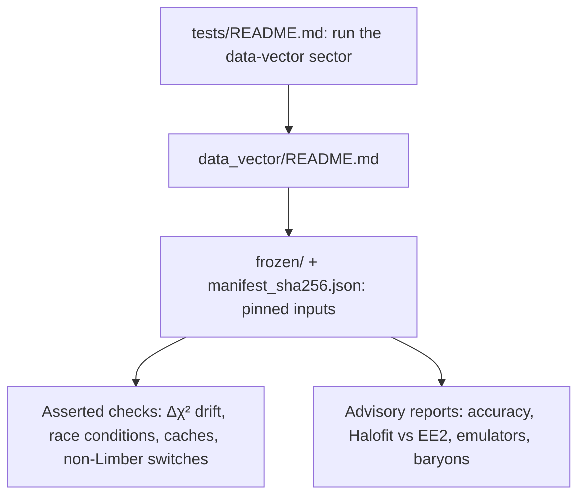

# Tests

The DESI DR3 x LSST Y1 tests and optional studies are organized as
follows.

- [Data-vector and likelihood checks](data_vector/README.md) cover the
  project predictions, frozen inputs and numerical diagnostics,
  including the thin-bin non-Limber engine this project depends on.
- <a name="optional_studies"></a>[Optional studies](studies/README.md#optional_studies)
  compare n(z) reconstructions and numerical accuracy, with plots and
  $\Delta\chi^2$ results. Run them separately from the routine tests.

Covariance generation is production tooling, not a test sector: its
machinery, notebook and guide live in [covariance/](../covariance/README.md)
at the project root. A covariance test sector like LSST Y1's is not
ported yet.



Every data-vector test reads only the pinned snapshot in `frozen/`.
Asserted checks fail the run when a number moves: the $\Delta\chi^2$
checks against `frozen/reference_chi2.json`, the race conditions (OpenMP
threading), the cache ladder, the EuclidEmulator2 modification pin, the
baryonic-feedback drift tests, the photo-z and non-Limber switches, and
the FKEM vs low-rank engine comparison at an equal multipole cap on the
four DESI layouts (DR3 comoving bins and the DR1 $\Delta z$ = 0.02, 0.05
and 0.2 binnings).
Advisory checks print measurements without a pass limit: the accuracy
scans (with and without feedback), Halofit versus EuclidEmulator2, and
the hybrid emulators.

We assume Cocoa and this project are installed, the Cocoa Conda
environment is active, the shell is Bash, and the current folder is
`cocoa/Cocoa/`. Run one project's tests per Python invocation: another
project's same-named test helpers must not be imported into the same
process.

**Step :one:**: activate Cocoa.

```bash
source start_cocoa.sh
```

**Step :two:**: run the data-vector sector.

```bash
python -m pytest ./projects/lssty1xdesi/tests/data_vector
```

The project must be enabled in `set_installation_options.sh` before
activation. Read the sector guide to distinguish asserted regressions
from advisory accuracy reports.

Frozen configurations and inputs are protected by
`manifest_sha256.json`. Do not regenerate references to silence an
unexplained failure. The sector guide documents the deliberate
reference-update procedure and its limits.
