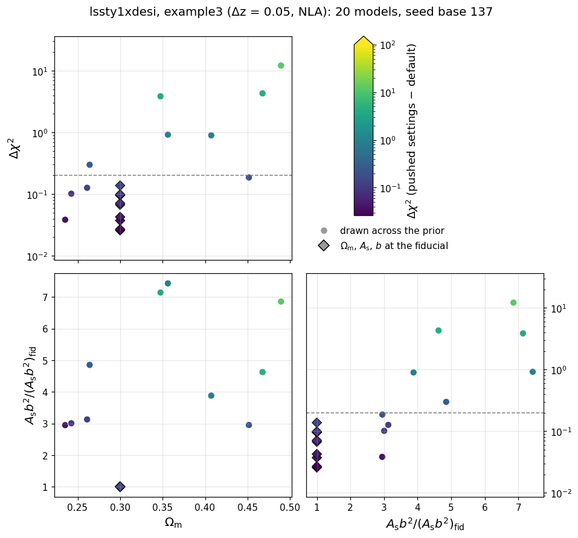
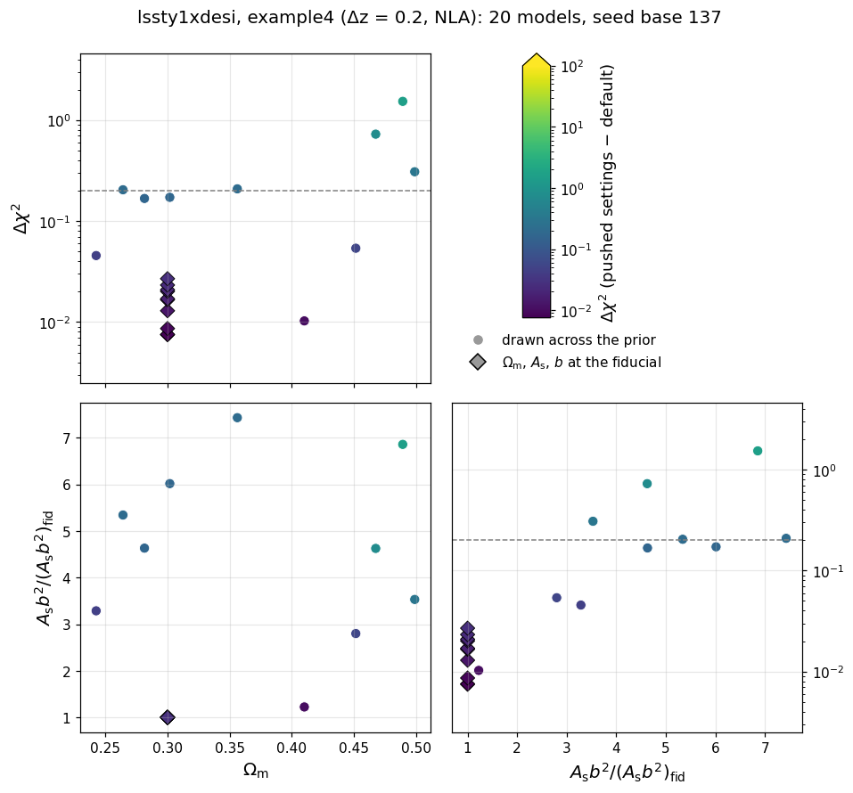

# Data-vector and likelihood tests

The frozen snapshot `frozen/` and its manifest `manifest_sha256.json`
live in the parent `tests/` directory; the paths below are relative to
it.

These tests catch two kinds of silent breakage: a $\chi^2$ that drifted
because code or data changed by accident, and a race condition (a bug
where evaluating several points in a row corrupts a later result
through leftover internal state or colliding OpenMP threads). These
tests also measure the accuracy of the numerical settings, the hybrid
emulated pipelines and the baryonic-feedback models, and report whether
they are accurate enough for data analysis (advisory: no pass/fail).

The mechanism of every shared check family - the frozen-reference and
race contract, the zero-baseline construction, the sweeps and their
`--high`/`--mask` options, the accuracy settings and their meanings -
is documented once in
[the shared data-vector checks](https://github.com/CosmoLike/cocoa-cosmolike-core/blob/main/README.md#dv_checks)
of the CosmoLike core. This file records what this project runs and
what it measured.

The suite freezes four DESI layouts of the same clustering likelihood,
plus one emulated variant. Every layout has 53 band powers per
spectrum, on the bands $15 \le \ell \le 544$ of width
$\Delta\ell = 10$. The LSST Y1 cosmic-shear rows (15 pairs) are part
of each layout and masked.

| configuration | likelihood | lens bins | cross pairs | entries (unmasked) |
|---|---|---:|---:|---:|
| `example1` | `desi_cl`: DESI DR3, bins of fixed comoving width | 76 | 97 | 9,964 (5,309) |
| `example2` | `desi_cl_dr1_dz0p02`: DESI DR1, $\Delta z = 0.02$ | 90 | 133 | 12,614 (7,621) |
| `example3` | `desi_cl_dr1_dz0p05`: DESI DR1, $\Delta z = 0.05$ | 36 | 52 | 5,459 (2,982) |
| `example4` | `desi_cl_dr1_dz0p20`: DESI DR1, $\Delta z = 0.2$ | 10 | 13 | 2,014 (744) |
| `emul2_example1` | `desi_cl` with the hybrid emulators | 76 | 97 | 9,964 (5,309) |

`example1` carries the project's full suite. The Δz layouts are frozen
for the FKEM vs low-rank engine comparison, which needs each one's own
fiducial.

Each layout samples 13 DESI nuisance parameters: one linear bias per
sample chunk (`DESI_B1_*`: BGS, LRG1-3, ELG1-2) and seven
finger-of-god velocity dispersions (`DESI_SIGV_*`, with BGS split in
two). The likelihoods declare no source nuisance parameters
(intrinsic alignment amplitudes, shear calibration, source photo-z
shifts), so the TATT variants and the CFASTPT-vs-FASTPT sweep of the
donor suite have nothing to exercise. Declaring those parameters and
porting those tests is a follow-up of its own.

# Table of contents

1. [Running the tests](#run_tests)
2. [The tests](#the_tests)
    1. [The Halofit vs EE2 checks](#halofit_ee2)
    2. [The EE2 modification tests](#ee2_tests)
    3. [Advisory checks](#advisory_checks)
    4. [Accuracy checks](#accuracy_checks)
    5. [The N-random-models check](#nmodels_check)
    6. [Baryonic feedback checks](#baryon_checks)
    7. [The photo-z convention checks](#photoz_conventions)
    8. [The non-Limber checks](#nonlimber_checks)
    9. [The FKEM vs low-rank engine checks](#lowrank_check)
    10. [The n(z) reader and cache checks](#nz_readers)
    11. [The sector-ladder cache check](#cache_ladder)
3. [Appendix](#appendix)
    1. [FAQ: What does this project's snapshot hold?](#frozen_copy)
    2. [FAQ: How can maintainers refresh the snapshot?](#refreeze)

## Running the tests 

We assume users are in the Conda cocoa environment from a previous
`conda activate cocoa` command, that the shell is bash, and that the
current folder is the cocoa main folder `cocoa/Cocoa`. Every command
below assumes `start_cocoa.sh` has been sourced once:

    source start_cocoa.sh

Run the full suite with

    python -m pytest ./projects/lssty1xdesi/tests/data_vector

or, without pytest,

    python -m unittest discover -s ./projects/lssty1xdesi/tests/data_vector -v

The tests change no project files. Each test prints a progress line
per model build and per evaluation, then a report with the computed
$\chi^2$, the stored reference, the difference, and the pass limit.
The test files force `OMP_NUM_THREADS=4` internally. The accuracy,
nonlinear, baryon and engine comparisons dominate the runtime: the
9,964-point and 12,614-point layouts take minutes per model build.

## The tests 

The standard configuration gets two tests - the frozen-reference
drift check and the race check, in NLA
([mechanism](https://github.com/CosmoLike/cocoa-cosmolike-core/blob/main/README.md#dv_frozen)).
The suite follows the shared
[test-file naming convention](https://github.com/CosmoLike/cocoa-cosmolike-core/blob/main/README.md#dv_naming): a file name
means the same thing in every project. This project's
configurations and test numbers:

| file | configuration | tests |
|---|---|---|
| `test_example1.py` | `example1` (EE + gg + gg-cross band powers) | 1-2 |
| `test_nonlinear.py` | Halofit vs EE2 on `example1` | NL1 |
| `test_ee2.py` | modification pin; race | E-pin |
| `test_emul2.py` | hybrid emulators (advisory) | E1-E2 |
| `test_accuracy.py` | the knob scan and the all-knobs check | A0, A1 |
| `test_baryons.py` | feedback drift pins | BD1-BD7 |
| `test_accuracy_baryons.py` | feedback accuracy reports | BF0-BF7 |
| `test_photoz_conventions.py` | the runtime n(z) conventions | - |
| `test_nonlimber_gg.py` | non-Limber vs Limber clustering | - |
| `test_nonlimber_fkem_fair.py` | low-rank vs FKEM engine at an equal multipole cap, on all four layouts | - |
| `test_nonlimber_lowrank_gg.py` | both engines at the likelihood defaults (a drift pin) | - |
| `test_nz_histogram_reader.py`, `test_nz_cache_roundtrip.py` | n(z) file reading and cache rebuilds | - |
| `test_cache_consistency.py` | the sector-ladder cache check | - |

The snapshot was frozen on 2026-11-04 and refrozen on 2026-11-05,
with every layout's fiducial data vector regenerated at the reference
settings of the [N-random-models section](#nmodels_check). Each of
the four layouts reproduces its frozen reference at $\chi^2 = 0$: its
shipped data vector is the model at its fiducial point. The refreeze
moved the $\Delta z = 0.05$ fiducial vector by $\Delta\chi^2 = 0.033$
against the previous version, with the largest single entry moving by
$0.02\sigma$.

The numbers below are measured with CAMB installed with the halofit
tolerance patch (`PATCH_CAMB_HALOFIT_TOLERANCE` in
`set_installation_options.sh`). Stock CAMB stops halofit's bisection
for the nonlinear scale at $|\sigma(R) - 1| \le 10^{-3}$ and the patch
at $10^{-7}$. The references were frozen with stock CAMB; on the
patched CAMB, `example1` scores $\chi^2 = 0.013$ against them, inside the
0.2 limit.

### The Halofit vs EE2 checks (`test_nonlinear.py`, NL1) 

[Mechanism](https://github.com/CosmoLike/cocoa-cosmolike-core/blob/main/README.md#dv_halofit_ee2):
NL1 evaluates the full band-power vector with both nonlinear-power
sources at the ten shared cosmologies. Measured:

- median $\Delta\chi^2 = $ 441, maximum 4,007
  (advisory; no pass limit).
- These are far larger than LSST Y1's shear-only numbers because the
  vector weighs 173 thin-bin clustering spectra with spectroscopic
  precision: a percent-level difference between the two nonlinear
  $P(k)$ prescriptions is resolved at high significance. The two
  sources are not interchangeable for this project; an analysis must
  pick one and state it.

### The EE2 modification tests (`test_ee2.py`) 

[Mechanism](https://github.com/CosmoLike/cocoa-cosmolike-core/blob/main/README.md#dv_ee2):
the test pins the physics of Cocoa's EuclidEmulator2 modifications
against the pre-modification build, plus the race check with EE2 on.
Measured: max $\Delta\chi^2 = $ $4.8\times10^{-7}$ over the ten cosmologies
(limit 0.2).

### Advisory checks (`test_emul2.py`, E1-E2) 

These checks test the hybrid emulators: trained machine-learning
networks replace the Boltzmann code. There is no pass/fail; each
check prints the emulated $\chi^2$, its drift against the stored
emulator reference, its error against the exact-physics $\chi^2$ at
the same point, and a recommendation (RECOMMENDED below 0.2).

Measured: the emulated fiducial scores $\chi^2 = $ 4.44 against
the exact-physics frozen vector. The spectroscopic thin bins resolve
transfer-function differences that LSST Y1's photometric vector
blurs, so the shipped networks are not recommended for data analysis
on this project until retrained at this precision.

> [!NOTE]
> The trained-network files are read from
> `external_modules/data/emultrf`, not from the `frozen/` snapshot; the
> network device is pinned to `cpu` so the numbers do not depend on
> GPU availability.

### Accuracy checks (`test_accuracy.py`, A0-A1) 

[Mechanism, setting meanings and cost order](https://github.com/CosmoLike/cocoa-cosmolike-core/blob/main/README.md#dv_accuracy):
check A0 scans one setting at a time on `example1` (including
`accuracyboost: 5` as a stress test); A1 re-evaluates the vector with
every shared setting pushed at once. Beyond the shared knobs, the scan
covers this project's own non-Limber controls:

- the FFTLog $\chi$-grid density (`nonlimber_accuracyboost`): the
  accuracy-critical control, because the narrowest bins in $\ln\chi$
  alias on a coarse grid;
- the kept SVD ranks (`nonlimber_lowrank_rank`, default 5);
- the engine's multipole cap (`nonlimber_lowrank_lmax`, default 1000).

Measured on 2026-11-04 (A0, one knob at a time, advisory), at the
settings `example1` shipped then: `accuracyboost` 1 with
`nonlimber_accuracyboost` 64, the same combined $\chi$-grid factor as
the current `accuracyboost` 2 with 32. The scan's re-measurement at
the reference settings of the
[N-random-models section](#nmodels_check) runs with the full suite
and is pending:

| setting | change | $\chi^2$ against the frozen vector |
|---|---|---:|
| none (the default) | - | 0.0130 |
| `accuracyboost` | 1 → 3 | 0.131 |
| `accuracyboost` (stress) | 1 → 5 | 0.148 |
| `internal_accuracyboost` | 1 → 2 | 0.0130 |
| `integration_accuracy` | 0 → 10 | 0.0130 |
| `lmax` | 5000 → 20000 | 0.0130 |
| `kmax_boltzmann`, CAMB `kmax` | → 40, → 50 | 0.0130 |
| CAMB `AccuracyBoost` | 1.05 → 2 | 0.0975 |
| CAMB `k_per_logint` | 10 → 50 | 0.0130 |
| `nonlimber_accuracyboost` | 64 → 128 | 0.0157 |
| `nonlimber_lowrank_rank` | 5 → 8 | 0.0130 |
| `nonlimber_lowrank_lmax` | 1000 → 2000 | 0.0151 |

A1 (every shared knob at once): $\Delta\chi^2 = $ 0.180.

Every row includes the 0.013 that the default itself scores on the
patched CAMB. Two settings move the vector: cosmolike's
`accuracyboost: 3` (0.131; 0.148 at `accuracyboost: 5`) and CAMB's
`AccuracyBoost: 2` (0.098). Doubling the project's three non-Limber
controls adds at most 0.003, so their defaults are adequate at this
precision. Every row stays inside the 0.2 band, and so does A1.

Run them on their own, or skip them (high-accuracy evaluations of this
vector are slow):

    python -m pytest ./projects/lssty1xdesi/tests/data_vector/test_accuracy.py
    python -m pytest ./projects/lssty1xdesi/tests/data_vector --ignore ./projects/lssty1xdesi/tests/data_vector/test_accuracy.py

### The N-random-models check (opt-in) 

[Mechanism](https://github.com/CosmoLike/cocoa-cosmolike-core/blob/main/README.md#dv_nmodels):
seeded random points across the prior, each scored with every setting
of the A-checks pushed at once against its own reference-settings
vector. Each layout has its own check (`test_ax99_nmodels` for
`example1`, `test_ax99_nmodels_example2` to `_example4`). Model $m$
draws its point with the seed $137 + m$, so every run repeats the same
points and the same figures. Enable and run it with

    COCOA_ACCURACY_NMODELS=10 python -m pytest \
        ./projects/lssty1xdesi/tests/data_vector/test_accuracy.py -k nmodels

Running the file as a script accepts `--nmodels N` in place of the
environment variable. Two more variables change a run:

- `COCOA_ACCURACY_NMODELS_SEED` sets another seed base, for a second
  reproducible set of points;
- `COCOA_ACCURACY_NMODELS_FIGURES` names the folder of the figures
  (unset: the system temporary folder, so the run changes no project
  file).

Unlike A0-A4, this check fails: every model must stay below
$|\Delta\chi^2| = 0.2$, and a failure names each model and its seed.
Three settings in `test_accuracy.py` shape the draw to the prior of
the examples:

- `nmodels_box`: $\Omega_m$ is drawn in $[0.2, 0.5]$, $w_0$ in
  $[-3, -1/3]$ (an accelerating universe today) and $w_0 + w_a$ in
  $[-3, -0.01]$, the boxes of the examples. The frozen configurations
  keep their wider boxes, and the overrides narrow the draw without a
  refreeze; they change only the drawn values of a seeded point.
- `nmodels_hold`: every odd model (seed 138, 140, ...) resets
  $\Omega_m$, the primordial amplitude $A_s$ (sampled as `As_1e9`
  $= 10^9 A_s$) and the DESI linear galaxy biases $b_i$ to the
  fiducial after its draw,
  so only the other cosmological parameters vary ($H_0$, $n_s$,
  $\Omega_b$, $m_\nu$, $w_0$, $w_0 + w_a$). Those models measure what
  the other parameters do to the accuracy. The FoG dispersions have
  Gaussian priors and keep their fiducial values in every draw.
- `nmodels_amplitude_cut`: every drawn point keeps the
  clustering-amplitude ratio
  $(A_s/A_{s,{\rm fid}})(b_i/b_{i,{\rm fid}})^2$ at or below 8 in
  every one of the six DESI bias groups - the amplitude cut of the
  examples' prior, and the cut shared by all projects in this group.
  A draw above the cut is replaced by the next draw of the same
  seeded generator, so the points stay reproducible.

The cut is what makes the check passable at all. Every bias box spans
$[0.8, 4]$ while the ELG fiducial bias is 0.84, so an uncut draw
reaches $A_s b_i^2$ of about 50 times its fiducial value, and a
numerical error that is a fixed fraction of the signal costs a
$\Delta\chi^2$ that grows as the square of that ratio. The Fisher
forecasts of `EXAMPLE_EVALUATE4.ipynb` (section 8) put the DESI
$2\sigma$ contours at an amplitude ratio of about 2, so the cut at 8
removes only prior volume the data already exclude.

Each check prints a summary of each half and draws its layout's
figure: $\Delta\chi^2$ against $\Omega_m$ and against the
clustering-amplitude ratio (the largest over the six bias groups),
and the plane of the two. Circles are drawn across the prior;
diamonds hold $\Omega_m$, $A_s$ and the biases at the fiducial, so
they stack at $\Omega_m = 0.3$ and ratio 1. The color saturates
above 100.

Each model is scored against a reference vector generated at the
settings its likelihood ships (finalized 2026-11-05; every layout at
`accuracyboost` 2 and CAMB `AccuracyBoost` 1.05):

| layout | `nonlimber_accuracyboost` | `kmax_boltzmann` |
|---|---:|---:|
| DR3 (`example1`) | 32 | 20 |
| $\Delta z = 0.02$ (`example2`) | 32 | 20 |
| $\Delta z = 0.05$ (`example3`) | 16 | 20 |
| $\Delta z = 0.2$ (`example4`) | 4 | 20 |

`kmax_boltzmann: 20` is set by the low-$\Omega_m$ corner of the
prior. At a drawn point with $\Omega_m = 0.237$, $w_0 = -2.39$,
$w_0 + w_a = -2.87$ and $H_0 = 78.6$, the pushed settings move
$\chi^2$ by 2.09 on DR3 and 2.06 on $\Delta z = 0.02$ against a
reference generated with `kmax_boltzmann: 5`, and by 0.12 and 0.10
against one generated with 20 (measured 2026-11-05).

Measured with the seed base 137 under this prior and these reference
settings:

| layout | models | held: median / maximum $\Delta\chi^2$ | drawn: median / maximum $\Delta\chi^2$ |
|---|---:|---:|---:|
| `example1` (DR3, 62 Mpc) | - | pending | pending |
| `example2` ($\Delta z = 0.02$) | - | pending | pending |
| `example3` ($\Delta z = 0.05$) | 20 | 0.069 / 0.138 | 0.60 / 12.1 |
| `example4` ($\Delta z = 0.2$) | 20 | 0.017 / 0.027 | 0.19 / 1.53 |

The `example1` and `example2` reruns under this prior are pending
(each takes an hour or more); their figures appear here once they
finish.

On $\Delta z = 0.05$ (measured 2026-11-05, 20 models) every held
model passes: the other cosmological parameters alone leave
$\Delta\chi^2$ at 0.138 or less. The drawn half:

| $\Delta\chi^2$ | $\Omega_m$ | amplitude ratio |
|---:|---:|---:|
| 12.1 | 0.489 | 6.86 |
| 4.30 | 0.468 | 4.62 |
| 3.85 | 0.348 | 7.14 |
| 0.92 | 0.356 | 7.43 |
| 0.90 | 0.407 | 3.88 |
| 0.30 | 0.264 | 4.85 |
| 0.19 | 0.452 | 2.95 |
| 0.13 | 0.261 | 3.13 |
| 0.10 | 0.243 | 3.01 |
| 0.038 | 0.235 | 2.95 |

Every drawn point with a ratio up to about 3.1 stays below 0.2. The
values above 1 sit at ratios of 4.6 or more together with
$\Omega_m \ge 0.35$, the extreme corner of the prior; the DESI
Fisher $2\sigma$ contours reach a ratio of only 1.54 on this layout.
No one-setting-at-a-time scan was run on this layout, so the residual
is not attributed to a particular setting.

On $\Delta z = 0.2$ (measured 2026-11-05, 20 models) every held
model passes: the other cosmological parameters alone leave
$\Delta\chi^2$ at 0.027 or less. In the drawn half the three largest
values sit at the high-amplitude, high-$\Omega_m$ corner the cut
still admits:

| $\Delta\chi^2$ | $\Omega_m$ | amplitude ratio |
|---:|---:|---:|
| 1.53 | 0.49 | 6.9 |
| 0.73 | 0.47 | 4.6 |
| 0.31 | 0.50 | 3.5 |

The other drawn values are 0.21, 0.20, 0.17, 0.17, 0.054, 0.046 and
0.010. A one-setting-at-a-time scan at the three worst points puts
this residual entirely on CAMB's precision: raising CAMB's
`AccuracyBoost` from 1.05 to 2 alone reproduces 1.55, 0.76 and 0.26,
while every cosmolike setting (`accuracyboost`, the non-Limber
$\chi$ grid, the integration accuracy, `lmax`) and CAMB's $k$ range
move these points by at most 0.13. The worst points combine high
$\Omega_m$ (0.47 to 0.50) with large neutrino masses (0.35, 0.21 and
0.08 eV) and a high amplitude. A higher CAMB `AccuracyBoost` would
cost much more per evaluation, and the project keeps 1.05.

The check's pass/fail line is the 0.2 budget, so these corner models
fail it. The project accepts these values at the extreme,
data-excluded corners of the prior - a high amplitude together with
high $\Omega_m$, where the DESI Fisher $2\sigma$ contours reach an
amplitude ratio of only 1.54 to 2.11 - as a documented judgment. It
flags a $\Delta\chi^2$ well above 1 only where the amplitude is
moderate, and none occurs here.

### Baryonic feedback checks (`test_accuracy_baryons.py` BF0-BF7, `test_baryons.py` BD1-BD7) 

[Mechanism](https://github.com/CosmoLike/cocoa-cosmolike-core/blob/main/README.md#dv_baryons):
the accuracy checks (BF) report the default-versus-pushed
$\Delta\chi^2$ with each feedback method on; the drift tests (BD) pin
each method's frozen prediction. The commented `bfmt` theory block in
`EXAMPLE_EVALUATE1.yaml` shows how to turn each method on. Measured:

| method | BD: $\chi^2$ against its frozen vector | BF: $\Delta\chi^2$, high accuracy vs default |
|---|---:|---:|
| SP(k), power-law $f_b$ relation | 0.0130 | 0.166 |
| SP(k), Akino et al. 2022 | 0.0130 | 0.166 |
| SP(k), double power-law $f_b$ relation | 0.0130 | 0.166 |
| BCEmu | 0.0129 | 0.166 |
| Flamingo response emulator | 0.0130 | 0.166 |
| BACCOemu | 0.0127 | 0.210 |
| BCemu2025 | 0.0130 | 0.166 |

Every drift test passes its 0.2 tolerance. The 0.013 in each is the
same patched-CAMB offset the default shows. The high-accuracy shift
is the same for six methods. BACCOemu's 0.210 is just above the 0.2
advisory band.

The BF0 scan (Akino SP(k) on) repeats the A0 knobs against a vector
the default model generates, so it carries no CAMB offset. It
confirms the A0 reading: `accuracyboost: 3` moves $\chi^2$ by 0.116
and CAMB's `AccuracyBoost: 2` by 0.086, and every other setting moves
it by at most 0.003.

    python -m pytest ./projects/lssty1xdesi/tests/data_vector/test_accuracy_baryons.py
    python -m pytest ./projects/lssty1xdesi/tests/data_vector/test_baryons.py

### The photo-z convention checks (`test_photoz_conventions.py`) 

[Mechanism](https://github.com/CosmoLike/cocoa-cosmolike-core/blob/main/README.md#dv_photoz):
the frozen fiducial under the default, each alternative convention,
and the default again. This project's n(z) files tabulate bin centers,
so its default z-column reading is `Z_MID`
(`photoz_zmid_convention: 1` in `likelihood/desi_cl.yaml`), and the
sweep's alternatives are the two other interpolants and the `Z_LOW`
reading. Measured:

| n(z) reading | $\chi^2$ against the frozen vector | $\Delta\chi^2$ against the default |
|---|---:|---:|
| `cspline`, `Z_MID` (default) | 0.0130 | - |
| `linear` | 0.0141 | $7.4\times10^{-4}$ |
| `steffen` | 0.0135 | $3.9\times10^{-4}$ |
| `Z_LOW` | 0.0440 | $3.0\times10^{-2}$ |

The interpolant barely matters. Reading the tabulated bin centers as
lower edges shifts every n(z) by half a table step and costs 0.03,
still inside the 0.2 band. The final return to the default reproduces
the first vector.

### The non-Limber checks (`test_nonlimber_gg.py`) 

[Mechanism](https://github.com/CosmoLike/cocoa-cosmolike-core/blob/main/README.md#dv_nonlimber):
`adopt_limber_gg: 0` in this project, with no Limber hand-off below
the engine's cap. The thin spectroscopic bins keep real non-Limber
power far past the $\ell = 150$ hand-off that photometric surveys use,
so the low-rank engine computes the full density-density term up to
its multipole cap.

Galaxy clustering on `example1` (the test stores the measured value
and re-asserts it to 5% relative - a drift pin on both projections,
not an accuracy limit):

- $\Delta\chi^2 = $ 21,158 between the non-Limber and
  pure-Limber predictions. The thin bins make the Limber
  approximation unusable for this project, not merely inaccurate.

The stored pin predates the 2026-11-05 settings change; it is being
re-measured with the full suite (see the note in the next section).

### The FKEM vs low-rank engine checks (`test_nonlimber_fkem_fair.py`, `test_nonlimber_lowrank_gg.py`) 

The project computes its non-Limber clustering with the low-rank
FFTLog engine (`nonlimber_lowrank_gg: 1`). A per-bin SVD compresses
$\sqrt{P_{gg}}$ to `nonlimber_lowrank_rank` rank-one profiles, whose
FFTLog projections rebuild every auto and cross spectrum up to
`nonlimber_lowrank_lmax`, with no Limber hand-off inside that range.
With the engine off (`nonlimber_lowrank_gg: 0`), clustering uses FKEM.
FKEM projects the separable linear spectrum exactly with FFTLog and
adds, in Limber, what linear theory misses. It does so below its own
cap `lmax_nonlimber` and is pure Limber above it. The cross pairs get
the same split.

A comparison of the two methods is fair only at equal caps.
`test_nonlimber_fkem_fair.py` sets `lmax_nonlimber: 550` in every
build. That is above the highest band center (539.5), so FKEM is
non-Limber at every band, like the engine (which ignores the key). The
two runs then differ only in how they treat the nonlinear part of
$P_{gg}$: FKEM keeps it in Limber, while the engine projects the full
nonlinear $P_{gg}$.

The test evaluates the engine, then FKEM, then the engine again in one
process, for each layout. It asserts that only clustering entries
change, that the round trip is bitwise, that the difference matches
its pinned value to 10%, and that the engine reproduces the frozen
reference. The frozen data vector is the engine's own prediction, so
each pin equals the $\chi^2$ the FKEM run scores against it. Every
layout runs on its likelihood's $\chi$ grid.

| layout | lens bins | cross pairs | unmasked entries | `nonlimber_accuracyboost` | $\Delta\chi^2$, FKEM vs engine |
|---|---:|---:|---:|---:|---:|
| DR3, comoving bins (`example1`) | 76 | 97 | 5,309 | 64 | 74.0 |
| DR1, $\Delta z = 0.02$ (`example2`) | 90 | 133 | 7,621 | 64 | 92.7 |
| DR1, $\Delta z = 0.05$ (`example3`) | 36 | 52 | 2,982 | 32 | 5.23 |
| DR1, $\Delta z = 0.2$ (`example4`) | 10 | 13 | 744 | 8 | 0.147 |

The difference grows as the bins get thinner and more numerous. On
the ten $\Delta z = 0.2$ bins it is 0.147, below the 0.2 band of the
reference tests. On the 36 $\Delta z = 0.05$ bins it reaches 5.2, and
on the thin layouts it is 74 (the 76 comoving DR3 bins, about 62 Mpc
wide) and 93 (the 90 $\Delta z = 0.02$ bins). Keeping the nonlinear
part of $P_{gg}$ in Limber is therefore adequate only for wide
spectroscopic bins; the thin layouts need the engine's full
projection. Measured on 2026-11-04.

The pinned differences above, and the drift pins of
`test_nonlimber_gg.py` and `test_nonlimber_lowrank_gg.py`, were
measured at the settings the likelihoods shipped on 2026-11-04
(`accuracyboost` 1 with the `nonlimber_accuracyboost` column above).
The likelihoods now ship `accuracyboost` 2 with
`nonlimber_accuracyboost` 32, 32, 16 and 4, the same combined
$\chi$-grid factor, and the pins are being re-measured at these
settings with the full suite, which is pending.

The full projection costs more. The test prints each engine's
steady-state evaluation time (4 OpenMP threads, Apple M2 Pro laptop
on AC power, measured 2026-11-05):

| layout | low-rank engine | FKEM, cap 550 | ratio |
|---|---:|---:|---:|
| DR3, comoving bins (`example1`) | 12.7 s | 7.1 s | 1.8 |
| DR1, $\Delta z = 0.02$ (`example2`) | 15.0 s | 8.5 s | 1.8 |
| DR1, $\Delta z = 0.05$ (`example3`) | 4.6 s | 2.9 s | 1.6 |
| DR1, $\Delta z = 0.2$ (`example4`) | 1.6 s | 1.4 s | 1.2 |

`test_nonlimber_lowrank_gg.py` runs the same sweep on `example1` at the
likelihood defaults. There FKEM's cap is 150, so every band above
$\ell = 150$ is Limber, and the difference measures that hand-off,
not the method. It is kept only as a regression pin on both engines.

The rank-5 compression itself costs nothing at this precision (the A0
scan's rank 5 → 8 row moves leaves $\chi^2$ at 0.012999, the default's value to six digits).

Run them on their own (each layout builds three models):

    python -m pytest ./projects/lssty1xdesi/tests/data_vector/test_nonlimber_fkem_fair.py
    python -m pytest ./projects/lssty1xdesi/tests/data_vector/test_nonlimber_lowrank_gg.py

### The n(z) reader and cache checks (`test_nz_histogram_reader.py`, `test_nz_cache_roundtrip.py`) 

The histogram reader test checks the file-to-spline path of the n(z)
machinery against an independent Python reading; the roundtrip test
flips the runtime n(z) flags away from and back to the defaults in
one process and asserts the rebuilt cache reproduces the original
vector bit for bit. Both matter more here than in photometric
projects: the FoG convolution (`external_nz_modeling: 1`) rebuilds
the 76 thin lens distributions at every evaluation.

### The sector-ladder cache check (`test_cache_consistency.py`) 

The deterministic mixed-update ladder and its bitwise assertions are
described in
[the shared checks](https://github.com/CosmoLike/cocoa-cosmolike-core/blob/main/README.md#dv_cache_ladder).
This project samples cosmology, galaxy bias and the FoG velocity
dispersions only, so the source-side rungs (IA, source photo-z, shear
calibration) drop out of the ladder, the TATT variant skips, and bias
still moves at the scramble point.

## Appendix 

## :interrobang: FAQ: What does this project's snapshot hold? 

The snapshot-protection mechanism is described in
[the shared checks](https://github.com/CosmoLike/cocoa-cosmolike-core/blob/main/README.md#dv_frozen).
This project's `frozen/` holds:

| `frozen/` entry | holds |
|---|---|
| `frozen_config_example1.py` to `frozen_config_example4.py` | each layout's configuration as a yaml string, plus the exact evaluation point |
| `frozen_config_emul2_example1.py` | the `example1` configuration with the hybrid emulators, plus the exact evaluation point |
| `data/` | the tests' own copy of the project's `data/` folder (data vectors, covariances, n(z) histograms, window functions, masks, pair lists), plus the baryonic-feedback vectors the generator writes |
| `reference_chi2.json` | the reference $\chi^2$ values, one per configuration and variant |
| `EXAMPLE_EVALUATE1.yaml` to `EXAMPLE_EVALUATE4.yaml` | snapshots of the live examples, kept only so a human can diff how they drifted since the freeze |
| `EXAMPLE_EMUL2_EVALUATE1.yaml` | snapshot of the hybrid example, kept for the same reason |

## :interrobang: FAQ: How can maintainers refresh the snapshot? 

A deliberate change to the data vector, n(z), covariance, examples,
or likelihood defaults requires a re-freeze. The `_meta` block of
`frozen/reference_chi2.json` records when the current references were
generated.

We assume users are in the Conda cocoa environment from a previous
`conda activate cocoa` command, that the shell is bash, and that the
current folder is the cocoa main folder `cocoa/Cocoa`.

**Step :one:**: activate the private Python environment by sourcing
the script `start_cocoa.sh`

    source start_cocoa.sh

**Step :two:**: rebuild the snapshot

    python ./projects/lssty1xdesi/tests/generate_frozen_reference.py --overwrite

It deletes and rebuilds `frozen/` from the current project, prints one
reference $\chi^2$ per configuration, and rewrites the manifest. This
step does not write the baryonic-feedback vectors of
`test_baryons.py`.

**Step :three:**: write the baryonic-feedback vectors

    python ./projects/lssty1xdesi/tests/generate_frozen_reference.py --baryons

It evaluates each feedback method once, writes its vector and dataset
file under `frozen/data/`, and re-pins the manifest. Review the
printed $\chi^2$ values of both steps before committing: they become
the new references the tests compare against.

**Step :four:**: re-measure and re-pin the non-Limber deltas. They
belong to the frozen vectors:

- `test_nonlimber_gg.py`: the `measured=` value;
- `test_nonlimber_fkem_fair.py`: `DCHI2_MEASURED` (`example1`) and
  `DCHI2_MEASURED_CASES` (`example2` to `example4`);
- `test_nonlimber_lowrank_gg.py`: `DCHI2_MEASURED`.

After a re-freeze, run each file once with `-s`, read the printed
`delta^T C^-1 delta` of every layout, and update the stored values.
