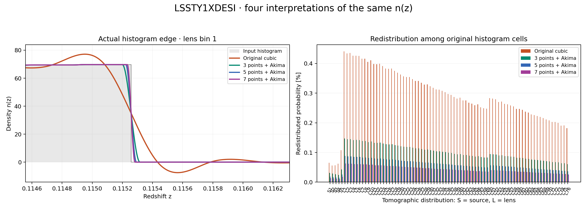
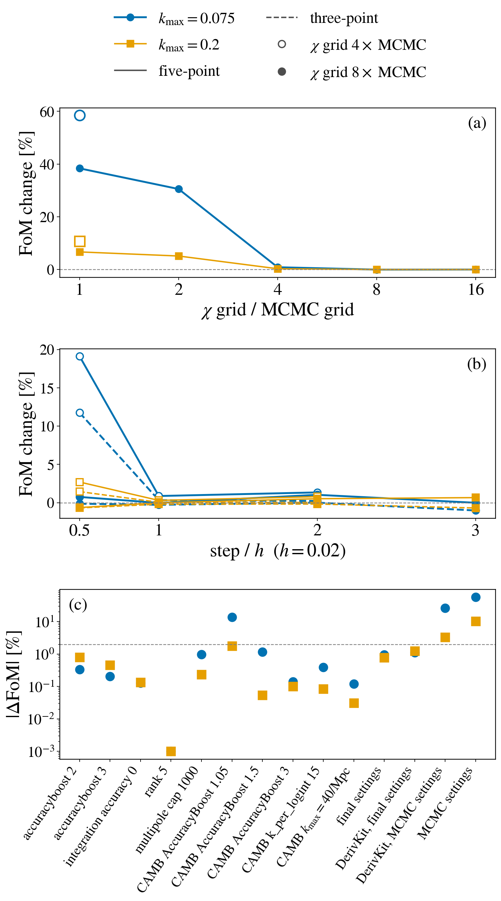

# DESI DR3 x LSST Y1: optional n(z) reconstruction study

## :interrobang: FAQ: What are optional studies? <a name="optional_studies"></a>

Optional studies explore how numerical settings and modeling choices
affect predictions; they can be expensive, so they run separately from
the routine tests. The shared guide to this n(z) reconstruction study -
the reconstruction definitions, the distance metric, the area
accounting, the figure construction and the run options - is
[The n(z) reconstruction study](https://github.com/CosmoLike/cocoa-cosmolike-core/blob/main/cosmolike_notebook_utils/README.md#nz_study)
in the CosmoLike core. This file records this survey's measurements.

This survey is the study's stress case: the 76 DESI lens
distributions are 0.05-wide spectroscopic bins, so each histogram is
a near-top-hat a smooth interpolant must trace without ringing, while
the 5 LSST source distributions behave like the photometric surveys
the study was built on.

## The survey figure



## Measured model-vector distances

All arms use the stored NLA example point, this survey's histogram
files, mask and supplied covariance, at the shared study settings;
the distance is the guide's $`\Delta\chi^2`$, judged against practical
stability at 0.2.

| Original → 3 | 3 → 5 | 3 → 7 | 5 → 7 |
|---:|---:|---:|---:|
| 1.5452461 | 0.063152472 | 0.13030892 | 0.014820323 |

Original at its YAML defaults versus the refined study settings:
**Δχ² = 2.2978655** - numerical accuracy alone, without changing
the histogram interpretation.

Both numbers are two to three orders of magnitude above their LSST Y1
analogs (0.021 and 0.0022), and the figure shows why: on a 0.05-wide
spectroscopic bin the original cubic spline rings around the top-hat
edge - overshooting the plateau and dipping below zero outside it -
while the Akima reconstructions trace the edge monotonically. The
interpolant choice and the default numerical settings both sit near
this survey's statistical precision, so neither is a free convention
here: the frozen references pin the original cubic at the YAML
defaults, and moving to an Akima reconstruction is a deliberate,
re-freezing change.

## Measured area accounting

| Reconstruction | Total-area range | Largest redistributed fraction |
|---|---:|---:|
| Original cubic | 0.999948163-1 | 0.441034% |
| 3-point Akima | 1-1 | 0.147087% |
| 5-point Akima | 1-1 | 0.088252% |
| 7-point Akima | 1-1 | 0.063037% |

## Run the study <a name="run_study"></a>

The environment setup, stage selection and accuracy options are in the
shared guide ([Run the study](https://github.com/CosmoLike/cocoa-cosmolike-core/blob/main/cosmolike_notebook_utils/README.md#nz_run)). For this survey, from
`cocoa/Cocoa/` with the cocoa environment active:

```bash
python -m pytest projects/lssty1xdesi/tests/studies/study_nz_reconstruction.py -v -s
```

or, keeping the results in a chosen folder:

```bash
python projects/lssty1xdesi/tests/studies/run_nz_reconstruction.py --output <folder>
```

To redraw the committed figure without a cosmology calculation:

```bash
python projects/lssty1xdesi/tests/studies/generate_nz_reconstruction_figures.py
```

# DESI DR3 x LSST Y1: optional Fisher-derivative convergence study <a name="fisher_derivatives"></a>

## Why derivatives need their own accuracy

A Fisher forecast is built from the derivatives of the data vector
$`m`$ (the DESI band powers) with respect to every parameter $`p`$. A
finite-difference derivative divides the difference of two nearby
vectors by a small step, so it amplifies every numerical error of $`m`$
that is not smooth in $`p`$: a chi grid that resamples thin redshift
kernels, tables whose nodes move, CAMB at its default accuracy.

The MCMC settings of the example yamls converge one $`\chi^2`$: they keep
$`\Delta\chi^2 < 0.2`$ against finer settings. That does not converge a
derivative. On the $`\Delta z = 0.05`$ layout the MCMC settings move the
fiducial vector by only $`\Delta\chi^2 = 0.015`$ against the converged
settings, yet they raise the paper model's dark-energy figure of merit
by 58% at $`k_\mathrm{max} = 0.075`$ h/Mpc.

This study finds the accuracy settings at which the derivatives stop
changing what they feed: the marginalized errors, the figures of merit
and the break-test shifts of the forecasts.

## What the study scores

The study scores two Fisher systems, each assembled the way
`EXAMPLE_EVALUATE_FISHER_MODEL.ipynb` assembles it, from the model A
likelihood at its fiducial point, where models A and B coincide:

- the paper model: model B with tilts, on the pessimistic linear-bias
  prior, at $`k_\mathrm{max}`$ = 0.075 and 0.2 h/Mpc;
- model A on the baseline linear-bias prior, at $`k_\mathrm{max}`$ =
  0.075 h/Mpc.

The tilts are linear trends in redshift of the bias nuisance parameters
across the bins of each bias group. Each $`k_\mathrm{max}`$ is a value
at z = 0: bin $`i`$, of mean redshift $`\bar z_i`$, keeps the scales
allowed by the UV-fraction cut (arXiv:2603.13031) at
$`k_\mathrm{max}/D(\bar z_i)`$, with $`D`$ the linear growth factor
normalized to one at z = 0, intersected with the shipped mask. The
study's cuts keep the same entries as the notebooks' cuts.

Every configuration runs on the layout's paper dataset (the
`data_file` override that `fm.derivative_settings` adds, as in the
notebooks), whatever example yaml provides the likelihood class. The
recorded runs read the exploration yamls' `*_linear` datasets, whose
pair lists, masks, bin tables, n(z) and ell files were then identical
to the paper datasets' (only their fiducial data vectors differ, and a
data vector does not enter a derivative).

For each system and cut the study records:

- the marginalized errors $`\sigma`$ of $`w_0`$, $`w_a`$, $`\Omega_m`$
  and $`A_s`$;
- the figures of merit $`\mathrm{FoM}(w_0, w_a)`$ and
  $`\mathrm{FoM}(\Omega_m, 10^9 A_s)`$;
- the shifts of the break test under its four truths.

Here $`w_0`$ and $`w_a`$ set the dark-energy equation of state
$`w(a) = w_0 + w_a(1 - a)`$, $`\Omega_m`$ is the matter density today
in units of the critical density, and $`A_s`$ is the primordial
amplitude of the scalar perturbations. A figure of merit is the inverse
square root of the determinant of the marginalized 2×2 covariance
$`C`$ of a parameter pair, so it grows as the error ellipse shrinks:

```math
\mathrm{FoM}(w_0, w_a) = \frac{1}{\sqrt{\det C_{w_0 w_a}}}
```

The break test of the Fisher notebook adds to the vector a term the
fitted model lacks, a truth: the radial counterterm $`\alpha_2`$, the
stochastic amplitude SN2 = 5, offsets of the quadratic and tidal biases
$`b_2`$ and $`b_{s2}`$ at one prior width, or a calibration drift of
those two biases. Its shift is the linear response of the best fit:
$`(w_0, w_a)`$ in units of its marginalized ellipse, $`\Omega_m`$ and
$`A_s`$ in units of their $`\sigma`$. A model breaks when a shift
exceeds $`\sigma/3`$.

## The derivative columns

The Fisher matrix is $`F = D^T C^{-1} D`$, where $`C`$ is the data
covariance and column $`j`$ of $`D`$ is the derivative
$`\partial m/\partial p_j`$. The study builds three kinds of columns:

| Columns | Parameters | Rule |
|---|---|---|
| Stencil | the seven cosmological parameters and the seven velocity-dispersion groups $`\sigma_v`$ | five-point stencil |
| Per bin, on a coloring | the bin amplitude `DESI_B1_<n>` ($`b_2`$ and $`b_{s2}`$ follow $`b_1`$), the offsets `DESI_DB2_<n>` and `DESI_DBS_<n>`, the counterterm `DESI_A0_<n>` = $`\alpha_0`$ | five-point stencil |
| Exact templates | the stochastic amplitudes SN0 and SN2, the counterterm `DESI_A2_<n>` = $`\alpha_2`$ | linear terms: templates; $`\alpha_2`$ by a central difference, exact for a linear term |

The cosmological parameters are $`10^9 A_s`$, the spectral index
$`n_s`$, the Hubble constant $`H_0`$, the baryon density $`\Omega_b`$,
$`\Omega_m`$, $`w_0`$ and $`w_a`$. The velocity dispersion $`\sigma_v`$
sets the Fingers-of-God damping of each DESI sample; $`b_1`$ is the
linear bias of a bin.

The five-point stencil, with $`d`$ the step:

```math
\frac{\partial m}{\partial p} \simeq \frac{-m(p + 2d) + 8\,m(p + d) - 8\,m(p - d) + m(p - 2d)}{12\,d}
```

The three-point (central) difference $`[m(p + d) - m(p - d)]/(2d)`$ is
off by a term of order $`d^2`$ times the third derivative of $`m`$; the
five-point combination cancels that term and leaves one of order
$`d^4`$. The step cannot shrink without limit: the numerical noise of
one evaluation enters the derivative divided by $`d`$.

A parameter with a nonzero fiducial value $`p_0`$ takes the step
$`d = h\,\lvert p_0\rvert`$, where $`h = 0.02`$ is the relative stencil
step; $`w_a`$, whose fiducial value is zero, takes $`d = h`$. The
per-bin parameters have their own steps, and a step change ($`h/2`$,
$`2h`$) scales every step together.

A per-bin column steps one bin. To save evaluations the study colors
the bins so that no measured cross pair joins two bins of one color,
and steps every bin of one color at once: each spectrum then involves
at most one stepped bin. $`\Delta z = 0.05`$ needs four colors.

The study also estimates the noise of one evaluation from the five
equally spaced stencil points. Their fourth difference
$`m(p - 2d) - 4m(p - d) + 6m(p) - 4m(p + d) + m(p + 2d)`$ is negligible
for a smooth vector, and independent noise gives it $`\sqrt{70}`$ times
the noise of one point ($`1 + 16 + 36 + 16 + 1 = 70`$). Whitened by the
shipped-mask covariance, the estimate is in units of $`\sqrt{\chi^2}`$.

## Two routes to the per-bin columns

The shipped parameter files tie each per-bin bias parameter to its
group. The model A derivative caches of `chains/`
(`EXAMPLE_EVALUATE_FISHER_MODEL_A_DERIVATIVES_<n>.pkl`) hold per-bin
columns taken by stepping the per-bin arrays the likelihood passes to the
compiled bias setter: $`b_1`$, $`b_2`$, $`b_{s2}`$ and $`\alpha_0`$ of a bin,
inside the interface. The study unties every per-bin parameter instead, samples it
at its fiducial value and steps it through the likelihood, as a chain
would.

At equal settings the two routes compute the same columns: the study's
`DESI_B1_<n>` column is the model A chain rule of the notebook's
$`b_1`$, $`b_2`$ and $`b_{s2}`$ columns. The `agree` stage compares the
two routes on $`\Delta z = 0.05`$ at the final tier and writes
`results/fisher_derivatives_agreement_dz0p05.json`. The $`b_2`$,
$`b_{s2}`$ and $`\alpha_0`$ columns agree exactly, the chain-rule
$`b_1`$ column to $`5\times10^{-11}`$ of its largest entry and the
cosmology and $`\sigma_v`$ columns to $`5\times10^{-14}`$: the
notebooks' cache and the study's final-settings arrays are the same
derivatives.

## The ladder of configurations

One configuration, the reference, sets every control above its MCMC
value. Every other configuration lowers one control and keeps the rest
at the reference, so each change of the scores belongs to one control.
The chi grid also goes above the reference, to find where it converges.
The controls are:

- the stencil rule, three-point against five-point;
- the step: $`h/2`$, $`h`$, $`2h`$, and $`3h`$ at grid 256;
- cosmolike's `accuracyboost`, `integration_accuracy`, chi grid,
  low-rank rank and low-rank multipole cap;
- CAMB's `AccuracyBoost`, `k_per_logint` and transfer
  $`k_\mathrm{max}`$.

`accuracyboost` scales cosmolike's tables (the redshift grids, the
$`P(k)`$ nodes, the multipole sampling, the FAST-PT grids), and
`integration_accuracy` sets the Gauss-Legendre orders of the Limber
integrals. The rank and the multipole cap belong to the low-rank engine
of the non-Limber spectra.

The chi grid is the comoving-distance grid of the non-Limber integrals.
One combined factor $`f`$ = `accuracyboost` × `nonlimber_accuracyboost`
sets it, rounded up to a power of two in the C code, and the grid holds
`NL_Nchi` nodes with `NL_Nchi` − 1 = 511 $`f`$. This page quotes the
grid as $`f`$. The MCMC grid is 32 on $`\Delta z = 0.05`$, 64 on
$`\Delta d_\mathrm{com} = 62`$ Mpc and $`\Delta z = 0.02`$, and 8 on
$`\Delta z = 0.2`$.

CAMB's transfer $`k_\mathrm{max}`$ is the likelihood's request
`kmax_boltzmann` × `accuracyboost`. The study divides both products by
`accuracyboost`, so a lower `accuracyboost` keeps the reference's chi
grid and CAMB $`k_\mathrm{max}`$.

| Setting ($`\Delta z = 0.05`$) | MCMC | Reference | Final |
|---|---:|---:|---:|
| `accuracyboost` | 2 | 4 | 3 |
| `integration_accuracy` | 0 | 2 | 1 |
| chi grid $`f`$ | 32 | 128 | 256 |
| low-rank rank (`nonlimber_lowrank_rank`) | 5 | 8 | 5 |
| low-rank multipole cap (`nonlimber_lowrank_lmax`) | 1000 | 2000 | 1000 |
| CAMB `AccuracyBoost` | 1.05 | 2 | 2 |
| CAMB `k_per_logint` | 15 | 30 | 30 |
| CAMB transfer $`k_\mathrm{max}`$ [1/Mpc] | 40 | 80 | 60 |

The reference evaluates every column at $`\pm h/2`$, $`\pm h`$,
$`\pm 2h`$ and $`\pm 4h`$, so the stencil rule and the step come from
the same evaluations; grid 256 adds $`\pm 3h`$ and $`\pm 6h`$.

CAMB's settings and the low-rank rank and multipole cap do not move
with the bias: they reach a per-bin column only through the fiducial
power spectrum that every step of that column shares. Those rungs, and
the chi grids above the reference, evaluate only the stencil block and
reuse the reference's per-bin columns.

## The tolerance

A configuration counts as converged when, against its base, every
marginalized $`\sigma`$ of $`w_0`$, $`w_a`$, $`\Omega_m`$ and $`A_s`$
moves by less than 2%, each figure of merit by less than 2%, and every
break-test shift by less than $`0.03\,\sigma`$.

A change of 1-2% in a figure of merit alters no conclusion of the
notes, and the noise of one evaluation moves the figure of merit at
$`k_\mathrm{max} = 0.075`$ by about that much between steps. A model
breaks at a shift of $`\sigma/3`$, so $`0.03\,\sigma`$ is a tenth of
that threshold. The compare stage marks each configuration against
these limits; the pytest run imposes no pass limit.

## The study figure



Every panel shows the paper model's $`\mathrm{FoM}(w_0, w_a)`$ on
$`\Delta z = 0.05`$ at $`k_\mathrm{max}`$ = 0.075 (circles) and 0.2
h/Mpc (squares). Panels (a) and (b) show its change relative to grid
512: (a) against the chi grid in multiples of the MCMC grid, with the
MCMC settings as open markers, and (b) against the step in units of
$`h`$ at grids 128 (open) and 256 (filled), five-point solid and
three-point dashed. Panel (c) shows the change of every other control,
of the final settings and of DerivKit against the reference (grid 128)
on a logarithmic axis, with the 2% tolerance dashed.

## Measured results

The numbers below are for $`\Delta z = 0.05`$, against grid 512 at the
reference's other settings, with the five-point rule at step $`h`$,
for the paper model unless model A is named. They are saved in
`results/fisher_derivatives_dz0p05_vs_chi_grid_quad.json`;
`results/fisher_derivatives_dz0p05.json` holds the same configurations
against the reference.

- Converged values (grid 512): $`\mathrm{FoM}(w_0, w_a)`$ = 0.157 at
  $`k_\mathrm{max}`$ = 0.075 and 2.497 at 0.2;
  $`\mathrm{FoM}(\Omega_m, 10^9 A_s)`$ = 1.000 and 21.89. Grid 256
  agrees to 0.03%.
- MCMC settings: $`\mathrm{FoM}(w_0, w_a)`$ +58% at 0.075 and +10.7%
  at 0.2; model A +114%.
- Chi grid alone: grids 32, 64 and 128 raise $`\mathrm{FoM}(w_0, w_a)`$
  at 0.075 by 38%, 31% and 0.9%.
- Columns: the $`w_a`$ column, then $`w_0`$ and $`\Omega_m`$, carries
  the chi-grid change; the per-bin and $`\sigma_v`$ columns move the
  figure of merit by less than 0.1%.
- Noise of one evaluation of the $`w_a`$ column, in $`\sqrt{\chi^2}`$:
  $`1.4 \times 10^{-2}`$ at the MCMC settings, $`1.8 \times 10^{-3}`$
  at the reference (grid 128), $`3.2 \times 10^{-4}`$ at the final
  settings.
- Other controls, each lowered alone at grid 128 (grid 128 alone is
  0.87% from grid 512): at 0.075, CAMB `AccuracyBoost` 1.05 moves the
  figures of merit by up to 16.6% and 1.5 by up to 2.7%; every other
  stays within 2%.
- Final settings: $`\mathrm{FoM}(w_0, w_a)`$ +1.8% and
  $`\mathrm{FoM}(\Omega_m, 10^9 A_s)`$ +1.6% at 0.075, both -0.5% at
  0.2; every $`\sigma`$ within 1.6%; shifts within $`0.007\,\sigma`$.
  Model A +1.6%, shifts within $`0.014\,\sigma`$.

The unconverged settings raise the figures of merit: noise in the
dark-energy columns adds spurious information to the Fisher matrix.

The final settings' +1.8% at $`k_\mathrm{max} = 0.075`$ sits in the
$`w_0`$, $`w_a`$ and $`\Omega_m`$ columns together. Swapping single
columns between the final and the grid-512 matrices moves the figure of
merit by -0.6% ($`\Omega_m`$), +2.7% ($`w_0`$) and +3.5% ($`w_a`$), in
opposite directions: the figure of merit at 0.075 is nearly degenerate
and turns column differences of $`10^{-3}`$ into percent changes.

## The convergence criterion: step independence

Agreement with a finer grid at one step is not enough. The truncation
error of a column shrinks with the step as $`d^4`$, while its noise
grows as $`1/d`$: a converged column gives the same scores over a range
of steps, and a noisy one changes when the step changes.

At grid 128, $`\mathrm{FoM}(w_0, w_a)`$ agrees with grid 512 at step
$`h`$ (0.9%), but halving the step raises it by 19% at
$`k_\mathrm{max} = 0.075`$ (2.7% at 0.2). At grid 256 the five-point
rule at $`h/2`$, $`2h`$ and $`3h`$ moves $`\mathrm{FoM}(w_0, w_a)`$ by
at most 1.0%, either figure of merit by at most 1.6% at 0.075 and 1.2%
at 0.2, and the shifts by at most $`0.027\,\sigma`$.

Grid 256 is the coarsest step-independent grid of the ladder, and the
final tier uses it on every layout: 8 times the MCMC grid of
$`\Delta z = 0.05`$, 4 times that of $`\Delta d_\mathrm{com} = 62`$ Mpc
and $`\Delta z = 0.02`$, and 32 times that of $`\Delta z = 0.2`$. The
grid-128 numbers stay in the results as the cross-check.

## The 62 Mpc spot check

The full ladder runs on $`\Delta z = 0.05`$. The thinnest layout, the
DR3 comoving bins of width $`\Delta d_\mathrm{com} = 62`$ Mpc, is where
the chi grid matters most. There the study evaluates the final
settings' stencil block at the step ladder (`candidate_ladder`, grid
256). It reads the per-bin columns, which move the figure of merit by
less than 0.1% on $`\Delta z = 0.05`$, from the notebooks' caches.

At step $`h`$, $`\mathrm{FoM}(w_0, w_a)`$ = 0.394 at
$`k_\mathrm{max}`$ = 0.075 and 7.44 at 0.2. Against these values, the
changes of $`\mathrm{FoM}(w_0, w_a)`$ at 0.075 and at 0.2 are:

- five-point at $`h/2`$: +0.0% and +0.13%;
- five-point at $`2h`$: -0.3% and -0.1%;
- three-point at $`h`$: -0.35% and -0.17%;
- model A ($`\mathrm{FoM}(w_0, w_a)`$ = 1.086 at 0.075): -0.2% at
  $`h/2`$ and -0.6% at $`2h`$.

Grid 256 is step-independent on the thinnest layout too, so one grid
serves every layout, and the same ladder at grid 512
(`candidate_chi_double_ladder`) is not needed. The results are saved in
`results/fisher_derivatives_dcom62_vs_candidate_ladder.json`.

The spot check ran on the 97-pair layout of 62 Mpc, before the 10
LRG3×ELG1 cross pairs were added to its paper dataset; step
independence at grid 256 does not depend on those pairs, so it was not
repeated. Its arrays in `chains/fisher_derivative_study/` describe that
older layout: the `compare` stage now refuses them (the stored vectors
and cuts no longer match the dataset), and a rerun of the spot check
starts with the `cuts` and `derive` stages.

Three-point columns at the exploration settings give
$`\mathrm{FoM}(w_0, w_a)`$ = 1.288 on this layout at
$`k_\mathrm{max} = 0.075`$, against 0.394 at the final settings. Swapped
alone into the final matrix, their $`w_0`$ column raises the figure of
merit by 41% and their $`w_a`$ column by 150%.

## DerivKit comparison

DerivKit (`external_modules/code/derivkit`, installed by Cocoa) samples
the vector at the center and at ±1, 1.5, 2.25, 3.4 and 5% of the
central value, fits a straight line weighted by the inverse distance to
the center, drops the points of largest residual down to 7
(`min_samples`), and returns the slope (fallback `poly_at_floor`). A
column costs 11 evaluations, against 4 for the five-point stencil.

The study replaces the stencil block and the `DESI_B1` and `DESI_DB2`
per-bin columns with DerivKit's, at the MCMC and at the final settings.
Against grid 512:

- MCMC settings: $`\mathrm{FoM}(w_0, w_a)`$ +27.5% at 0.075 (five-point:
  +58%), +3.6% at 0.2 (five-point: +10.7%); model A +49% (five-point:
  +114%);
- final settings: $`\mathrm{FoM}(w_0, w_a)`$ -0.3% at 0.075 (five-point:
  +1.8%), -0.9% at 0.2 (five-point: -0.5%).

At the final settings and $`k_\mathrm{max} = 0.075`$, DerivKit and
five-point differ by up to 2.2% in the $`\sigma`$, 2.05% in the figures
of merit and $`0.006\,\sigma`$ in the shifts. A DerivKit column takes
about 210 s there, against about 78 s for a five-point column (planning
estimate).

The recommendation is the five-point stencil everywhere. DerivKit is
not clearly better at the final settings and costs 2.75 times more; at
the MCMC settings it still leaves +27.5% (model A +49%).

## The two accuracy tiers <a name="derivative_tiers"></a>

The Fisher module `interface/cosmolike_lssty1xdesi_fisher.py` defines
two tiers of derivative settings for each DESI layout:

- `exploration`, in `DERIVATIVE_EXPLORATION`, for exploration notebooks
  and quick checks;
- `final`, in `DERIVATIVE_OVERRIDES` (likelihood options) and
  `DERIVATIVE_CAMB` (CAMB arguments), for every figure that goes into a
  paper or into a note's final version.

The exploration tier keeps each layout's yaml settings, with a finer
chi grid on $`\Delta z = 0.05`$ and a higher accuracy of both CAMB and
cosmolike on $`\Delta z = 0.2`$. Its figures of merit are not converged. The final
tier is the last column of the settings table, the same on every
layout; the rank and multipole cap stay at the yamls' values:

    accuracyboost: 3
    nonlimber_accuracyboost: 64    # chi grid 3 x 64 = 192, rounded up to 256
    integration_accuracy: 1
    kmax_boltzmann: 20             # CAMB transfer kmax 20 x 3 = 60/Mpc
    AccuracyBoost: 2               # CAMB
    k_per_logint: 30               # CAMB

`derivative_settings(dataset, tier)` returns the arguments of one
dataset in one tier. The tier is stored in every cache fingerprint, so
a derivative cache records which tier made it, and a cache of the
other tier does not match.

## The halofit requirement of the final tier <a name="halofit_patch"></a>

Halofit finds the nonlinear scale $`R`$ by bisection until
$`\lvert\sigma_\mathrm{lin}(R) - 1\rvert`$ is below a tolerance, with
$`\sigma_\mathrm{lin}(R)`$ the rms of the linear density field smoothed
on the scale $`R`$. Stock CAMB stops at $`10^{-3}`$. Where the
bisection stops jumps between nearby cosmologies, so the nonlinear
power spectrum jitters by about 0.3% and every finite-difference
derivative of the cosmology moves with the step. The patch tightens the
tolerance to $`10^{-7}`$.

`PATCH_CAMB_HALOFIT_TOLERANCE` (`set_installation_options.sh`) is on by
default in current Cocoa. An older install, or a CAMB clone made
without it, lacks the patch. `fm.check_halofit_patch` (`fm` is the
Fisher module, as the notebooks import it) stops the final tier without
it: it reads `external_modules/code/CAMB/fortran/halofit.f90` and
requires the compiled CAMB library to be newer than that file.

To add the patch, we assume `set_installation_options.sh` exports
`PATCH_CAMB_HALOFIT_TOLERANCE=1`, the cocoa environment is active, and
the current folder is `cocoa/Cocoa/`.

**Step :one:**: activate Cocoa.

```bash
source start_cocoa.sh
```

**Step :two:**: re-clone CAMB, which applies the patch.

```bash
export OVERWRITE_EXISTING_CAMB_CODE=1
source ./installation_scripts/setup_camb.sh
unset OVERWRITE_EXISTING_CAMB_CODE
```

**Step :three:**: compile CAMB.

```bash
source ./installation_scripts/compile_camb.sh
```

> [!Warning]
> Re-cloning deletes `external_modules/code/CAMB`, including any local
> change to it.

## Run the study <a name="run_fisher_study"></a>

We assume Cocoa and this project are installed, the cocoa environment
is active, and the current folder is `cocoa/Cocoa/`. Run one study
process at a time: each one takes `COCOA_STUDY_THREADS` OpenMP threads
(default 8) and one BLAS thread, in place of the `OMP_NUM_THREADS=1`
that `start_cocoa.sh` exports for MPI chains.

The `derive` and `dkit` stages measure the final tier, so they stop
unless CAMB carries the halofit tolerance patch (`fm.check_halofit_patch`;
see [The halofit requirement of the final tier](#halofit_patch)).

The 62 Mpc spot check reads the model A derivative and template caches
of `chains/` for that layout
(`EXAMPLE_EVALUATE_FISHER_MODEL_A_DERIVATIVES_1.pkl` and
`EXAMPLE_EVALUATE_FISHER_MODEL_B_TEMPLATES_1.pkl`), so they must exist.
`EXAMPLE_EVALUATE_FISHER_MODEL.ipynb` writes the same arrays under
`EXAMPLE_EVALUATE_FISHER_MODEL_DERIVATIVES_<n>.pkl` and
`..._TEMPLATES_<n>.pkl`, with each group amplitude named after its group
(`DESI_B1_<g>`) instead of its leader bin.

### Every stage through pytest

**Step :one:**: activate Cocoa and set the study's thread count.

```bash
source start_cocoa.sh
export COCOA_STUDY_THREADS=8
```

**Step :two:**: run the study.

```bash
python -m pytest projects/lssty1xdesi/tests/studies/study_fisher_derivatives.py -v -s
```

The run evaluates the $`\Delta z = 0.05`$ ladder, DerivKit at the MCMC
and final settings, and the 62 Mpc spot check, each stage in its own
Python process. It writes into a fresh pytest folder, printed at the
end, and changes nothing in the repository. It does not run the
comparison against grid 512 or the `agree` stage.

### Stage by stage

The stages write their arrays to `chains/fisher_derivative_study/`
(gitignored, tens of MB per configuration) and their JSON summaries to
`tests/studies/results/`.

**Step :one:**: activate Cocoa and set the study's thread count.

```bash
source start_cocoa.sh
export COCOA_STUDY_THREADS=8
```

**Step :two:**: print every configuration's settings and evaluation
count.

```bash
python projects/lssty1xdesi/tests/studies/run_fisher_derivatives.py plan
```

**Step :three:**: compute the scale cuts and evaluate the ladder on
$`\Delta z = 0.05`$.

```bash
python projects/lssty1xdesi/tests/studies/run_fisher_derivatives.py cuts --layout dz0p05
for config in reference mcmc chi_grid_mcmc chi_grid_half chi_grid_double \
    chi_grid_quad accuracyboost_2 accuracyboost_3 integration_accuracy_0 \
    camb_accuracy_1p05 camb_accuracy_1p5 camb_accuracy_3 k_per_logint_15 \
    camb_kmax_40 rank_5 lowrank_lmax_1000 candidate; do
  python projects/lssty1xdesi/tests/studies/run_fisher_derivatives.py derive \
    --layout dz0p05 --config "${config}"
done
```

Each name says which control it lowers (`camb_accuracy_1p05` sets CAMB
`AccuracyBoost` to 1.05). `chi_grid_mcmc`, `chi_grid_half`,
`chi_grid_double` and `chi_grid_quad` set the chi grid to 1, 2, 8 and
16 times the MCMC grid, `mcmc` sets every control to its MCMC value,
and `candidate` holds the final settings.

**Step :four:**: compute the DerivKit columns at the final and the MCMC
settings.

```bash
for config in candidate mcmc; do
  python projects/lssty1xdesi/tests/studies/run_fisher_derivatives.py dkit \
    --layout dz0p05 --config "${config}"
done
```

**Step :five:**: score every configuration against the reference and
against grid 512.

```bash
python projects/lssty1xdesi/tests/studies/run_fisher_derivatives.py compare --layout dz0p05
python projects/lssty1xdesi/tests/studies/run_fisher_derivatives.py compare --layout dz0p05 \
  --base chi_grid_quad
```

**Step :six:**: run the 62 Mpc spot check.

```bash
python projects/lssty1xdesi/tests/studies/run_fisher_derivatives.py cuts --layout dcom62
python projects/lssty1xdesi/tests/studies/run_fisher_derivatives.py derive --layout dcom62 \
  --config candidate_ladder
python projects/lssty1xdesi/tests/studies/run_fisher_derivatives.py compare --layout dcom62 \
  --base candidate_ladder --perbin-from projects/lssty1xdesi/chains
```

**Step :seven:**: compare the per-bin routes against the model A
derivative cache of $`\Delta z = 0.05`$ at the final tier
(`chains/EXAMPLE_EVALUATE_FISHER_MODEL_A_DERIVATIVES_3.pkl`).

```bash
python projects/lssty1xdesi/tests/studies/run_fisher_derivatives.py agree --layout dz0p05
```

**Step :eight:**: redraw the committed figure, without a cosmology
calculation.

```bash
python projects/lssty1xdesi/tests/studies/generate_fisher_derivatives_figures.py
```

The figure generator reads `results/fisher_derivatives_dz0p05.json`
and writes `results/fisher_derivatives_dz0p05.png`. It also writes
`notes/fisher_machinery/plots/fom_convergence/data.json` and redraws
that note figure with the folder's `plot_fom_convergence.py`.

Planning estimates of the time of one evaluation, from runs on AC power
with no other heavy job:

- $`\Delta z = 0.05`$, MCMC settings: 3.9 s;
- $`\Delta z = 0.05`$, reference (grid 128): 17 s;
- $`\Delta z = 0.05`$, final settings: 19.5 s;
- $`\Delta z = 0.05`$, grid 512: 48 s;
- $`\Delta d_\mathrm{com} = 62`$ Mpc, final settings: 35.4 s.

The pytest run takes about a day on a laptop (planning estimate).
